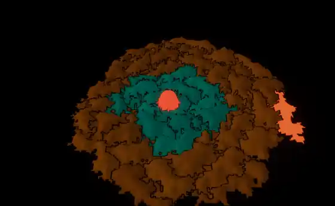
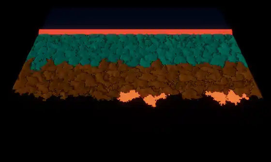

# cellweave

[](https://github.com/ngodzik/cellweave/actions/workflows/ci.yml) [](https://github.com/ngodzik/cellweave/actions/workflows/security.yml) [](https://github.com/ngodzik/cellweave/releases)

**A tissue that grows, starves, mutates, calls for blood and is hunted by immune cells, simulated cell by cell from a hypothesis written in a file, and set against real measurements.**

<p align="center">
  
</p>

> **Status: experimental, version 0.x.** cellweave is a research and teaching tool in early development, and anything in it may change from one version to the next. What it produces are hypotheses worth testing, not facts about real tumours. It gets better through feedback from people who know the biology or the modelling: a mechanism that is wrong or too simple, public data it should be set against, a value that should be different. If that is you, please [open a scientific feedback issue](https://github.com/ngodzik/cellweave/issues/new?template=scientific-feedback.md). Every comment is read.

## What it does

Every cell is a set of pixels with a shape, pressing on its neighbours. Inside each one runs a network of proteins, written in a plain file, that decides whether it grows, waits, divides, leaves or dies. Around the cells, oxygen and signals diffuse, taken up and released wherever the cells are. Nothing in the code says what shape the tissue takes: it follows from those three scales acting on each other, and changing the hypothesis is changing the file.

<table>
<tr>
<td width="50%"></td>
<td width="50%"></td>
</tr>
<tr>
<td><b>Killers that come for the tumour.</b> Immune cells arrive through the vessel, follow the trail the tumour cells leave, and kill the cells they touch, at measured rates. <a href="docs/22-killers-that-come-for-the-tumour.md">Chapter 22</a></td>
<td><b>A normal tissue that ages.</b> A renewing layer in which every cell starts a clone of its own; clones are lost by chance, mutants compete for room, and the layer keeps its size. <a href="docs/07-a-tissue-that-holds-its-size.md">Chapter 7</a></td>
</tr>
<tr>
<td width="50%"></td>
<td width="50%"></td>
</tr>
<tr>
<td><b>Vessels that grow.</b> Starving cells call for vessels, and a sprout climbs the call, branching into the tissue; with flow switched on, blood then goes where pressure drives it. <a href="docs/14-vessels-that-grow.md">Chapter 14</a>, <a href="docs/19-blood-that-flows.md">19</a></td>
<td><b>A tumour that evolves.</b> A daughter is not always a copy: each mutation founds a clone, nothing says which is good, and selection finds the ones that grow. <a href="docs/06-a-population-that-evolves.md">Chapter 6</a></td>
</tr>
</table>

Also in it: a spheroid that starves from the inside at the size measured spheroids do ([chapter 25](docs/25-measured-against-spheroids.md)), a lethal stress and the resistance it selects, rewinding a history to see what one mutation changed, and campaigns that run many histories side by side.

## Set against real data

The values below are fixed by public measurements, and every comparison is in the course with the prediction written before it ran, the ones that failed included; what no public data fixes yet is listed in its last chapter. The data are never copied here: each dataset is a [recipe](datasets/) saying where its authors published it, and `scripts/fetch-dataset.py` downloads it to your machine.

| what | public data | how close |
|---|---|---|
| a tumour's oxygen | 994 melanoma spheroids ([Browning 2021](https://doi.org/10.7554/eLife.73020)) | one number fitted; arrest then starts where the spheroids' does; their late cycling rim is thinner |
| cords of tissue around a vessel | [Tannock 1968](https://doi.org/10.1038/bjc.1968.34) | 69 µm against 60 to 120, nothing fitted |
| immune killing | [Weigelin 2021](https://doi.org/10.1038/s41467-021-25282-3), [Halle 2016](https://doi.org/10.1016/j.immuni.2016.01.010) | set on the measured rates |
| clones in a normal tissue | 1,222 clones of the mouse oesophagus ([Piedrafita 2020](https://doi.org/10.1038/s41467-020-15258-0)) | a third too large at a month, five times at six: a mechanism is missing |

## Try it

Download the command line for Linux, macOS or Windows from the [releases](https://github.com/ngodzik/cellweave/releases), or build it with Rust 1.97 or newer:

```bash
git clone https://github.com/ngodzik/cellweave && cd cellweave
cargo build --release

# a tumour cord around a vessel; numbers per step in output-cord/measurements.csv
./target/release/cellweave --config examples/cord.toml --mcs 1000

# ten histories of the same tumour, with and without immune cells, compared pair by pair
./target/release/cellweave --config examples/cord-wide.toml --versus examples/cord-immune.toml --seeds 1-10 --mcs 1000
```

Every scenario is a file in [`examples/`](examples/), and every chapter of the course says which file and which command give its results.

### Watching it

The viewer draws a run live, in relief, from the same simulation and the same seed. It is a workspace of its own, so the simulator never needs anything graphical; on Linux it needs `libwayland-dev` and `libxkbcommon-dev`.

```bash
cd viewer
cargo run --release -- --config ../examples/cord-angiogenic.toml
cargo run --release -- --config ../examples/capillary-delivery.toml --view flow
cargo run --release -- --config ../examples/epithelium-mutating.toml --view clone
```

Space pauses, N takes one step, R restarts, H flattens the relief, A turns the camera, the mouse turns and zooms it. The panel colours the cells by fate, protein, oxygen, stress, the call for vessels, clone or blood flow, and plots the population as it goes.

`--record <dir>` saves every step as an image, taken from what the viewer draws rather than from the screen, and `--until <step>` stops there; with `--no-panel`, `--spin` and `--batch <steps>`, that is how the animations above were made:

```bash
cargo run --release -- --config ../examples/cord-immune.toml --no-panel --batch 3 --record frames --until 1000
ffmpeg -framerate 30 -pattern_type glob -i 'frames/*.png' run.mp4
```

## Learn how it works

[The course](docs/README.md) explains the program from the biology up, in 26 chapters, each answering one question: what a thing is in the body, what cellweave makes of it, which choices were made and why, where in the code it lives, and what is still a placeholder. It is kept in step with the code, and its last chapter lists what the model does not say.

## Under the hood

Rust, in four crates whose dependency graph enforces the layering: `cellweave-core` (types, no I/O, no computation), `cellweave-engine` (the lattice, the networks, the fields, the loop), `cellweave-io` (configuration and output) and the command line; the viewer sits on top in a workspace of its own. The same seed gives the same run, byte for byte, on any machine and any number of threads, and the CI checks it on every push, with fmt, clippy, docs, 164 tests green on Linux, macOS and Windows, the oldest supported Rust, and `cargo-deny`.

```bash
cargo fmt --all -- --check
cargo clippy --workspace --all-targets -- -D warnings
cargo test --workspace
```

## Contributing, data, citing

[CONTRIBUTING.md](CONTRIBUTING.md) says how, and how to contribute a calibration. The repository holds no data of anyone else's and never any about a person. To cite cellweave, use [CITATION.cff](CITATION.cff) (GitHub's "Cite this repository"), with the version you used.

## Who is behind it

A personal project. I am a software engineer, not a biologist, and I started cellweave to learn multiscale modelling by building it. I write it with AI assistance, and I review and own everything in it, mistakes included. Mature, validated tools exist for this kind of work, among them [PhysiCell](https://physicell.org), [CompuCell3D](https://compucell3d.org), [Morpheus](https://morpheus.gitlab.io) and [Chaste](https://www.cs.ox.ac.uk/chaste/); cellweave overlaps with them by design.

## License

MIT. See [LICENSE](LICENSE).
