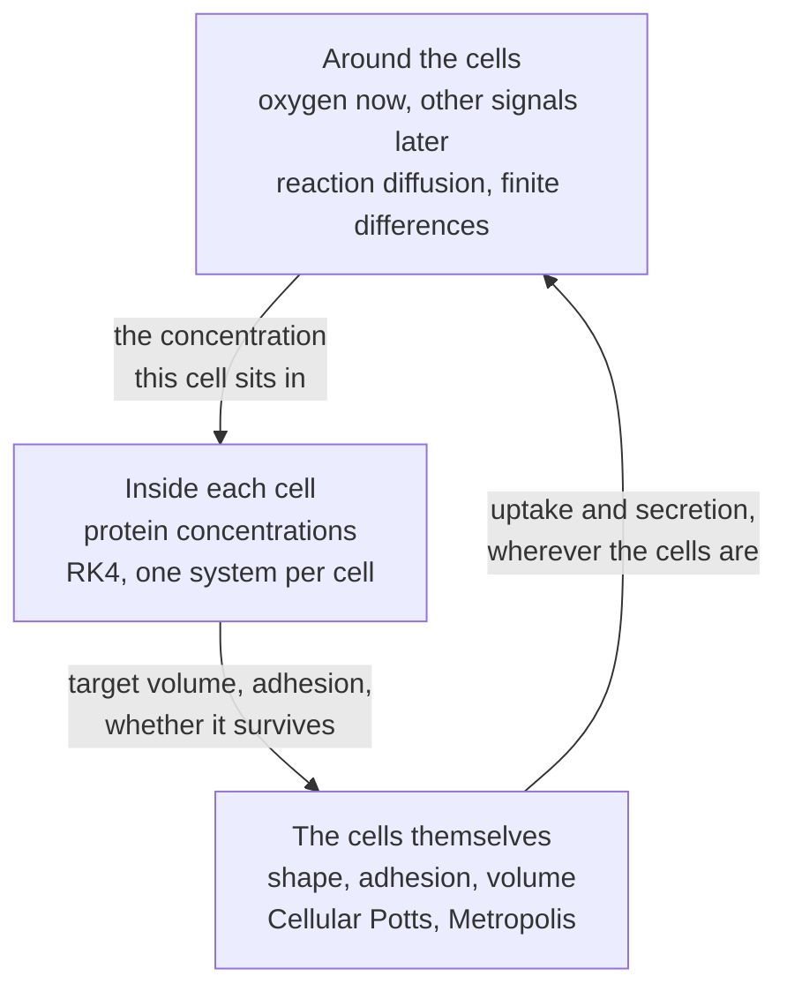
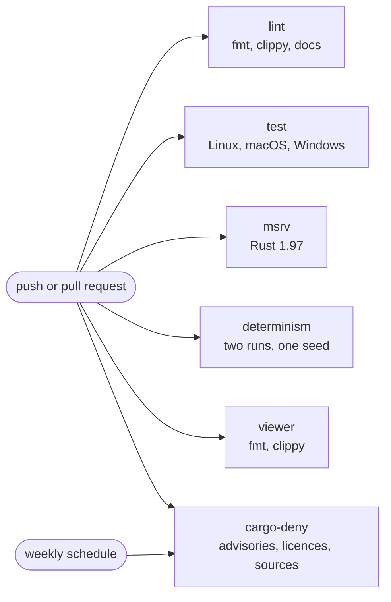
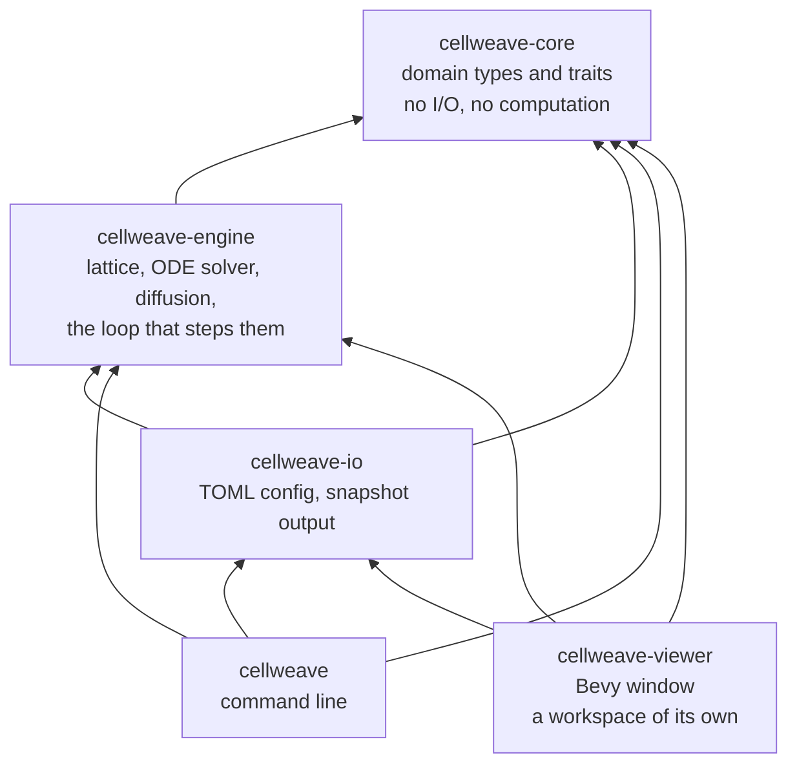

# cellweave

[](https://github.com/ngodzik/cellweave/actions/workflows/ci.yml) [](https://github.com/ngodzik/cellweave/actions/workflows/security.yml)

**cellweave runs a molecular hypothesis inside every cell, and shows what it does to the tissue.**

## What that means

A *molecular hypothesis* is a claim about biology: which proteins act on which, in which direction, and how fast. For example, low oxygen raises HIF-1a, HIF-1a raises BCL2, and BCL2 keeps the cell alive. Stated in words it sounds plausible. Written as equations it becomes something you can run.

A *tissue* here is not a sheet of paper. It is a population of cells sitting next to each other, pushing on each other, and sharing whatever diffuses between them.

So the program takes a hypothesis stated at the scale of molecules inside one cell, gives a copy of it to every cell in the population, lets the cells consume and release into the space around them, and reports what the whole population ends up doing. The question it answers is not "is this protein important" but "if this network is what is really inside each cell, what shape does the tissue take".

## Why

Going from data to an explanation today is largely statistical association: this gene correlates with that outcome. What sits between the two, and is hard to get at, is the mechanism. A simulation is one way to state a mechanism precisely enough that it can be wrong.

It also does something an experiment cannot. It runs the counterfactual: the same population, the same random seed, one parameter changed, so the difference between the two runs is attributable to that parameter and to nothing else. And it can be searched, which means asking not only whether a hypothesis holds but which interventions on it produce a tissue that behaves differently.

Nothing here is validated, and none of it substitutes for an experiment. The output of a run is a hypothesis worth testing, never a result.

## How it works

Three scales, coupled, in one program:

- **The cells.** A Cellular Potts model on a lattice, where a cell is a set of pixels rather than a point. Cells have a shape, a surface, and neighbours they adhere to more or less strongly.
- **Inside each cell.** A small system of ordinary differential equations over protein concentrations, integrated per cell. Each cell carries its own state.
- **Around the cells.** Reaction diffusion fields for what moves through the space between cells, oxygen first.

The loop is the whole point. Cells change the environment that then decides their fate, so what the tissue does is not written anywhere in the code. All three arrows are wired for oxygen; what each still lacks is in [What does not work yet](#what-does-not-work-yet).



Behaviour has to follow from that model rather than from hardcoded rules. A cell grows, loosens its grip on its neighbours, or dies because its internal state says so, not because a flag was set. A necrotic core, if one appears, has to appear because the cells in the middle ran out of oxygen, not because the code drew a circle.

## Status

Early-stage personal project. Not production software, and not scientifically validated.

I am a software engineer, not a biologist. I started this to learn multiscale modelling by implementing it. I use AI assistance to write code faster and to pick up Rust idioms along the way, and I review and own everything here, mistakes included.

Mature, validated tools already exist for this kind of work. If you need results today, use CompuCell3D, Morpheus, PhysiCell or PhysiBoSS instead. cellweave overlaps with them by design, because reimplementing established methods is the point of the exercise. What differs is the engineering: Rust, a single binary, reproducible TOML configs.

Features will be added progressively, and this README will follow as they land.

## What works today

- Builds clean, `cargo clippy -D warnings` passes, 164 tests green
- 2D lattice with Monte Carlo spin flips and a volume constraint, with the boundary term pinned by four tests whose values are computable by hand
- **The protein network is a file, not code.** Any number of proteins, any topology, each declared with the terms that move it, drawn from a closed catalogue named after what each means in biology. The file also says which node answers which question the simulation asks a cell, and how growth becomes a demand on the lattice. So stating a different hypothesis is writing a different file, and two files under the same seed differ by exactly what you changed. The RAS/ERK network that used to be literals in the source is now `examples/networks/ras-erk.toml`, compiled in as the default so that the built-in hypothesis and one you write go through the same path; a test pins that the two produce identical trajectories to twelve decimals
- RK4 integration per cell, whose growth node sets how large its cell tries to be. This is the upward half of the coupling, protein state driving mechanics
- Cell division: a cell that grows past a threshold splits along a line through its centre of mass, and the daughter inherits a copy of the parent's network. One cell becomes a population
- The downward half of the coupling: every lattice step, the oxygen field is relaxed to its steady state against the current layout of the cells, living cells take up oxygen where they sit, and each cell reads the mean over its own pixels into its network. Three clocks, field, network and cell cycle, are kept in the order biology has them, and a test pins the network's response time
- Three fates from that reading: a cell proliferates, or goes quiescent when its hypoxia response is high, or dies when its survival signal collapses below the anoxia threshold. A necrotic cell holds its shape and stops consuming
- Two geometries, chosen in the configuration. In a **bath**, the medium around the tissue is held at full oxygen and a single cell grows into a spheroid that starves from the inside: a necrotic core appears without any rule placing it there, at the same size on a 200 and a 300 pixel grid. The run stops, and says so, the moment tissue touches the edge of the box. Around a **vessel**, an obstacle held at full oxygen with consuming stroma all around, the tissue grows into a tumour cord: living out to the depth diffusion can feed, dead beyond, the classic geometry of tumour hypoxia
- Dead cells are resorbed, giving up their pixels over a few dozen steps until nothing is left. In the cord that makes births balance deaths: about forty living cells, one born every three steps, the same one dying, for as long as the run lasts, without ever nearing the edge of the box. That steady turnover is what an evolving population needs, and what a growing spheroid cannot offer
- A diffusion field solved to its steady state every lattice step by projected successive over-relaxation in red-black order, spread over every core, since oxygen equilibrates far faster than anything a cell does. Time stepping is kept for what needs it and refuses a step the explicit scheme cannot take. The field reproduces the closed-form profile of a bathed disc
- TOML configuration, JSON snapshot output per saved step
- **Daughters can differ from their parents.** With a mutation rate set, a daughter may be born with one rate of its network scaled by up to two either way, founding a clone. Nothing says which change is good. In the evolving cord, selection finds by itself a clone whose hypoxia response is weaker, its cells stop arresting where oxygen runs low, the quiescent ring vanishes and the cord grows out of its steady state. Every clone, its parent and its mutation are written to `clones.json`
- **Normal tissue that renews itself.** A sheet of epithelium fills the box, every cell the founder of its own clone as in a lineage tracing experiment. Cells read how crowded they are, and a NOTCH node turns crowding into a chance per step of differentiating and leaving the layer, while their neighbours grow into the room and divide. Nothing counts cells, and the layer holds about 300 of them while renewing itself many times over. Without mutation clones are lost by chance alone (neutral drift, 393 clones down to 11 in 2700 steps); with mutation, clones that turn the growth pathway up press their neighbours out and sweep the layer one after another, without it ever changing size. That growth mutants win where sequencing of the real oesophagus finds NOTCH1 and TP53 mutants winning is a disagreement chapter 7 of the course states plainly, and chapter 11 resolves
- **A second way to die, and a stress that sets it off.** A network may name an apoptosis node, whose level is a cell's chance per step of starting its own programmed death; the cell then breaks up and is cleared, faster than necrotic debris. A lethal stress, an abstract agent, can be switched on in the configuration: it comes in where oxygen does, spreads, is taken up by the cells it reaches, and raises p53 and then caspase in the shipped network. Under continuous exposure the cord empties against its vessel and keeps a refuge of quiescent cells at its hypoxic edge, which the stress is used up before reaching; under periodic exposure it falls and grows back each time
- **A history can be rewound.** A run may suppress a mutation: it is drawn exactly as before, its clone is founded with the same number and the same first cell, and only the mutation is not made. Until that difference changes what a cell does, the two runs are the same run, to the last bit. `--attribute` runs a configuration, walks back through the mutations of the clone that leads at the end, and replays the history once per mutation with that one taken out. On the evolving cord, the two VEGF mutations of the winning line leave the history identical to the last bit, passengers shown exactly rather than inferred, and without the HIF-1α mutation the cord never escapes its arrest
- **Mutations that rewire.** With `rewiring` set, a share of mutations change the network's wiring instead of a rate: a node loses one of its terms, or gains a link from any input or node. On the evolving cord, the winning lines most often lose a brake: a growth relay that loses its decay and stays switched on, a hypoxia response that loses its sensor, a survival protein that no longer dies of anoxia. The cord touched the edge in seven seeds of eight, against four of the same eight without rewiring
- **Why NOTCH wins.** A network may cap the size a cell asks for, and every run reports, node by node, the share of the living whose lineage carries a change to it, as sequencing reports gene by gene. Chapter 7's two candidate explanations, tested as a two by two over ten seeds each: as long as cells press by growing, growth mutants take the whole layer, whether or not NOTCH can be lost; without pressing and with mutations only dimming a rate, nothing sweeps; only with no pressing and a NOTCH term that can be lost do NOTCH clones cover most of the layer (a median of 63%) and growth clones stay rare, as in the human oesophagus. The loss that wins is always NOTCH's baseline, the term that makes a cell leave with room around it
- **Units, for the sheet.** A run reports how often a living cell divides, what pairs of sisters did next, and how the surviving clones' sizes spread around their mean. Calibrated on the division rate of the mouse oesophagus, a step of the sheet is about 0.6 hours, which a configuration states as `hours_per_step`. The neutral sheet obeys the two laws of clone sizes measured by lineage tracing, survivors growing in proportion to time and sizes settling into an exponential, and its sisters do opposite things more often than chance, as in the mouse, though nothing in the model couples them but the room they share
- **A tumour among mutant clones.** A configuration may place a lesion in the sheet: at one step, the cells around the centre start carrying a network of their own, a moderate bias towards staying in the layer as early oesophageal tumours have, and are followed as one lineage. Under the default seed, a lesion placed in the ageing sheet of chapter 11 is gone in about 22 days, every cell of it having left the layer, while in a sheet that never mutated it is still there 50 days on, an anecdote, as twenty paired histories then showed. With `suppress_before`, every mutation before a step is drawn and not made, so the same sheet with the same luck can be run without its mutant clones, and a campaign follows the lesion. A lesion barely fitter than normal cells is lost by drift in 16 seeds of 20 either way, and the prediction that mutant neighbours would make the difference failed. Varying its fitness then found a window: a lesion fit enough to survive among normal cells (NOTCH's baseline at 0.5 or 0.3 of its rate) is lost in 2 and 0 seeds of 20 in the clean sheet, and in 15 and 12 among the mutant clones, which is what [Colom and colleagues](https://doi.org/10.1038/s41586-021-03965-7) concluded from mice: an early tumour lives or dies by its fitness relative to the clones around it. And which clones: a mutation can be undone at one step in every cell carrying it, so `--attribute` on a lesion undoes, at the step it appeared, each mutation of the clones that touched it. Undoing them all saved the lesion in each of three seeds; one single clone, keeping NOTCH low, was enough in one of them, while in the other two the purge was collective and redundant, any one NOTCH-loss neighbour enough without the others
- **Vessels that grow.** A network may name the node a cell secretes as a call for vessels, and a configuration may let the vessel answer: living cells secrete their VEGF into a field that diffuses and decays, a vessel wall that reads enough of it sprouts, and the sprout's tip climbs the gradient and lays new vessel behind it, held at full oxygen. Nothing is drawn, so a cord whose vessel may grow is the same run as one whose vessel cannot until the first sprout lays its first pixel. Paired over ten seeds at step 300, the cord with growing vessels held more living cells in every pair, 1.58 times as many in the median, and its living tissue stayed within about the same distance of a vessel as the plain cord's: new vessels made more sleeves of living tissue, not thicker ones. How much a tumour gained followed how many sprouts it had started, and then it stopped: in nine runs of ten every sprout had started by step 300 and the tumour held that size to step 1500, and a longer reach, meant to keep the vessels growing, let none start at all. With `perfusion = "on_joining"` a sprout carries blood only once its tip has joined another vessel and closed a loop; the prediction that this would starve the tumour failed: blind sprouts feed nobody, so the cells around them go on calling, and the tumour ends with several times as much vessel, most of it joined, and half the necrosis.
- **Who a call for vessels feeds.** A lesion may be centred anywhere, in a tumour as well as a sheet, which places a subclone by hand. Every node of a network is a fraction between zero and one and a starving cell's VEGF is already at one, so no cell can call louder than its neighbours; a patch can only call less. A patch that calls not at all, against the same patch marked, under the same seeds: at a VEGF reach of 30 pixels the silent patch kept about a third of the cells the marked one did, and the rest of the tumour lost nothing by it, so what a call brings goes mostly to the cells that make it. At 10 pixels the call never reached the vessel and silence changed nothing; at 100 it was diluted below the threshold and nothing sprouted at all.
- **Vessels that regress.** With `regress_after`, a sprout that still carries no blood that many steps after it started is taken back, with every sprout grown from it, and the wall it left may sprout again. Chapter 14's finding, that a tumour whose sprouts must join before they carry blood calls in more vessel than one fed at once and has fewer dead, survives a delay of 100 steps (more living cells than fed at once in 6 pairs of 10, as without regression, with 2.6 times the vessel) but not one of 50 (fewer living in 7). Regression did not always mean less vessel: a blind sprout that had stopped kept the wall around its start from ever sprouting again, and taking it back freed that wall, so the tumours that had started only one or two sprouts ended with more. Over 800 steps that mattered more: without regression 4 tumours of 10 stayed frozen with one to three sprouts and never reached the edge of the box; with it, all 10 did.
- **Cells pushed aside.** A run counts the cells a growing vessel crushes, and with `in_the_way = "pushed"` the vessel shoves the cells in its way outward instead of taking their pixels, so that no cell changes size. In 40 runs not one cell was crushed, and yet pushing changed the tumour: more living cells in 7 pairs of 10 and more sprouts (5 against 2 in the median), so that growing vessels gave 2.75 times the plain cord's living cells where they had given 1.58 times. Vessels that grow still feed a tumour, and a tumour whose sprouts wait for loops still calls in more vessel and has fewer dead; that it also keeps more living cells was the shortcut's doing.
- **A capillary in the plane.** Oxygen may come from a capillary lying across the box, which blood enters on one side and leaves on the other, rather than a vessel seen end on. The tissue grows into a layer along it. A line feeds deeper than a point: at the cord's uptake the layer is nearly twice as deep as the cord's sleeve, and at three times that uptake it is as deep (54 pixels against 53.6). Vessels growing from it, at a lower threshold since at the cord's no wall ever sprouted, gave 2.3 times the living cells in 10 runs of 10 and left not one cell necrotic.
- **Blood that flows.** With `perfusion = "flow"`, the vessels are a network of tubes: blood enters the capillary on the left, held at one pressure, leaves on the right, held at another, and runs through every vessel with a difference of pressure across it, as Poiseuille's law shares it out, solved exactly whenever a tip joins a vessel or a sprout regresses. A blind end carries nothing, and neither does a loop closed on one. Against blood through any closed loop, the tumour fed by flow had fewer living cells in 10 runs of 10 (95.5 against 145.5) and more dead in 10, though the share of its vessel carrying blood fell only from 83% to 73%: it laid less vessel.
- **What blood delivers.** With `half_delivery_flow`, a vessel delivers oxygen, and anything else blood brings, in proportion to the blood through it: half at the given share of the capillary's own flow, all of it at the capillary's. Against vessels that deliver in full whatever they carry, every one of 10 tumours ended with more vessel and fewer living cells (71.5 against 95.5): vessels carrying a little blood leave the cells around them calling, and the vessels they call carry little too. More vessel, and less fed, without any rule saying so.
- **Pruned by the flow.** With `prune_below`, a sprout carrying less than that share of the capillary's flow counts as dry and regresses like a blind end, unless a sprout grown from it carries enough. Pruning took back more sprouts in all 10 runs, and yet the network did not shrink (as much vessel in the median): every pruned sprout freed a wall that sprouted again. How many tumour cells lived moved by up to a sixth either way, with no direction.
- **Killers that come for the tumour.** With `[immunity]`, killer immune cells arrive through vessels carrying blood, climb a chemokine every living tumour cell secretes, and kill the tumour cells they touch, each a limited number of times. Against the plain cord, they held it in two kinds of history: in four runs of ten they killed 55 to 75 tumour cells and the cord fell to between 6 and 33 living cells; in most others they killed about 20 and changed little. No tumour was cleared, and every one had fewer necrotic cells.
- **Escape.** A network may name an evasion node, which shields a cell from immune cells in proportion to its level; `networks/ras-erk-pdl1.toml` adds PD-L1. Under immune cells, in a cord that mutates, the prediction that they would select the shield failed (higher in 5 runs of 10). The tumours escaped otherwise: five of ten outgrew their cord and reached the edge of the box, none without immune cells, some with every living cell carrying a change to HIF-1α and one with no shared mutation at all.
- **Measured against the mouse.** With `[tracing]` every cell of the sheet is marked once it has settled and its clone followed, as a lineage tracing experiment does, and `scripts/compare-clones.py` sets the clones against the 1,222 that [Piedrafita and colleagues](https://doi.org/10.1038/s41467-020-15258-0) counted in the mouse oesophagus at 10, 30, 84 and 182 days. The repository keeps no one else's data: `datasets/` holds recipes saying where each dataset is published and what fingerprint its files must have, and `scripts/fetch-dataset.py` downloads it from the source into `data/`, which git ignores (`CONTRIBUTING.md`). Calibrated on the mouse's division rate, the sheet's clones grow about six times as fast as the mouse's per division (44 cells at 84 days against 6.8), as if every division and departure were independent. Colder or stiffer cells barely help; making crowding the main reason a cell leaves brings the first month within half of the mouse's, not the next five, and stronger crowding empties the layer. What makes four divisions in five end with one daughter gone soon after birth, the mouse's pattern, is not in the model.
- **Measured against spheroids.** `scripts/compare-spheroids.py` sets a spheroid's structure, its radius, its arrested region and its core, against the 994 melanoma spheroids [Browning and colleagues](https://doi.org/10.7554/eLife.73020) measured, fetched by its recipe. One number fitted, the oxygen uptake, so that the model's core appears where a sphere with the same oxygen forms one, and the onset of arrest falls where the spheroids have it (0.84 of the core's radius in three runs, against 0.87 and 0.83); late, the model's cycling rim is twice too thick, where Murphy and colleagues found oxygen alone falls short, and its spheroid never stops growing, its dead core hardly losing volume. With that uptake, nothing fitted to cords, a cord around a vessel has a radius of 69 µm in 10 runs of 10, inside the 60 to 120 µm measured in a mouse tumour. The model's spheroid doubling every 50 steps against melanoma cells' 16 to 47 hours makes a tumour step 0.3 to 0.9 hours, at which sprouts grow several times too slowly and immune cells kill several times too slowly; killing at the measured rates, the same immune cells clear 8 cords of 10, where at chapter 22's rates they cleared none.
- **Many histories, paired.** `--seeds 1-20` runs a configuration under every seed at once, one per core, and `--versus` runs a second one under the same seeds and compares them pair by pair, so the history the two share drops out of the comparison. Each run reports where it ended, the leading lineage, and how resistant the living are, asked of their networks out of the tissue. On the evolving cord under a lethal stress, both predictions written beforehand were wrong: continuous exposure wipes the cord out to a refuge in 11 histories of 20 and fails in 9, by resistance in 4 and in 5 by a line that escaped its hypoxic arrest and grew out of the stress's reach; intermittent exposure never wipes it out, and resistance arises as often under it
- **A run measures itself.** Every step writes a row of `measurements.csv`: cells in each fate, born and resorbed, and the shape of the tissue as equivalent radii, how large the necrotic area is and how deep living tissue reaches from its oxygen supply. The run ends with a summary of the same, so two hypotheses are compared on numbers rather than by squinting at snapshots
- A viewer, in a workspace of its own, that runs the same loop under the same seed and draws the tissue as it grows, in relief: each cell a dome coloured by its fate, a protein, the oxygen it sits in or its clone, births flashing and deaths flaring, with the population and the shape of the tissue plotted alongside. See [Watching a run](#watching-a-run)
- CLI entry point, a thin driver over `Simulation`, the loop itself, which lives in the engine so that anything else that runs a simulation runs the same one

## What does not work yet

Listed plainly, because a green test suite is not the same thing as correct physics.

- **Only oxygen, crowding and VEGF are coupled.** Growth factor is still a hardcoded input the same for every cell. VEGF is secreted only where a configuration lets vessels grow, and new vessels carry blood from their first pixel unless a configuration makes them wait until they join another, and regress only when a configuration says so, all at once, and only for carrying no blood at all. Blood flows as pressure drives it only when a configuration says so, with one viscosity and one radius per kind of vessel, delivering in full wherever it flows unless a configuration ties delivery to flow. A growing vessel crushes the cells in its way unless told to push them, and then pushes them along straight lines; cells never push a vessel. Tumour and normal tissue meet only as a lesion placed in the sheet; the tumours grown from one cell around a vessel or in a bath have no normal tissue around them.
- **Only the field is parallel.** Solving it was the dominant cost and now runs on every core, the same to the last bit whatever their number: the cord runs about six times faster on a twenty-thread machine. The Monte Carlo step, which moves the pixels, still runs on one, because it draws from a single random sequence and splitting it would change which run a seed names.
- **Evolution is crude.** A mutation scales one rate or, with rewiring, gains or loses a term; it never changes a threshold or a contact energy, and its rate is a placeholder millions of times too high. Campaigns run tens of seeds, which say which routes exist, not how often each is taken in a real tissue.
- **Little calibration.** The sheet has a unit of time, fixed against one measured rate, and its clones, set against the mouse's, grow several times too fast. The tumour has an oxygen uptake fixed on measured spheroids and a unit of time known to within a factor of three; the stress has none, and the pixel is between 1 and about 1.3 µm. The uptake rate is a configuration value, but its two example values were chosen to make each geometry show its structure, not measured against anything.

## Building and running

Requires Rust 1.97 or newer, which is the minimum CI builds against.

```bash
cargo build --release
cargo test --workspace

# A spheroid in a bath, the default: one cell, 200x200, stops at the edge
./target/release/cellweave --config examples/spheroid.toml

# A tumour cord around a vessel: steady turnover, runs as long as asked
./target/release/cellweave --config examples/cord.toml --mcs 3000

# The same cord with mutation: clones compete, and one escapes hypoxic arrest
./target/release/cellweave --config examples/cord-evolving.toml

# The cord under a lethal stress, continuous, then on for 150 steps in every 500
./target/release/cellweave --config examples/cord-stress.toml --mcs 2500
./target/release/cellweave --config examples/cord-stress-periodic.toml --mcs 2500

# A sheet of normal epithelium that renews itself, and the same sheet ageing
./target/release/cellweave --config examples/epithelium.toml
./target/release/cellweave --config examples/epithelium-mutating.toml

# Why NOTCH wins: pressing or not, NOTCH lost or not, ten seeds each
./target/release/cellweave --config examples/epithelium-mutating.toml \
    --versus examples/epithelium-rewiring.toml --seeds 1-10 --output runs/pressing
./target/release/cellweave --config examples/epithelium-no-pressing.toml \
    --versus examples/epithelium-no-pressing-rewiring.toml --seeds 1-10 --output runs/no-pressing

# An early tumour placed in the ageing sheet at step 4000
./target/release/cellweave --config examples/epithelium-lesion.toml

# The fitter lesion, twenty paired histories: among the mutant clones, and in the same sheet without them
./target/release/cellweave --config examples/epithelium-lesion-strong.toml \
    --versus examples/epithelium-lesion-strong-unmutated.toml --seeds 1-20 --output runs/purged

# Which clones purged the lesion: each mutation around it undone at the step it appeared
./target/release/cellweave --config examples/epithelium-lesion-strong.toml --seed 3 --attribute --output runs/purged-by

# Ten paired histories: a cord whose vessel can grow against the same cord whose vessel cannot
./target/release/cellweave --config examples/cord-wide.toml \
    --versus examples/cord-angiogenic.toml --seeds 1-10 --mcs 300 --output runs/vessels

# Which mutations made the evolving cord: one replay per mutation of its winning line
./target/release/cellweave --config examples/cord-evolving.toml --attribute --output runs/attribution

# Twenty paired histories: continuous against intermittent stress on the evolving cord
./target/release/cellweave --config examples/cord-evolving-stress.toml \
    --versus examples/cord-evolving-stress-periodic.toml --seeds 1-20 --output runs/campaign

# The evolving cord whose mutations can rewire the network, under eight seeds
./target/release/cellweave --config examples/cord-rewiring.toml --seeds 1-8 --output runs/rewiring

# The sheet's clones against the mouse's: fetch the clones, mark every cell at step 1000, ten seeds, compare
python3 scripts/fetch-dataset.py datasets/piedrafita-2020.toml
for s in $(seq 1 10); do
  ./target/release/cellweave --config examples/epithelium-traced.toml --seed $s --output runs/traced/$s
done
python3 scripts/compare-clones.py --data data/piedrafita-2020/lrig1-clones.csv \
    --at 1000 --division-days 2.414 --progenitors 0.65 runs/traced/*

# A spheroid with the oxygen of measured melanoma spheroids, set against them (tens of minutes)
python3 scripts/fetch-dataset.py datasets/browning-2021.toml
./target/release/cellweave --config examples/spheroid-calibrated.toml
python3 scripts/compare-spheroids.py --data data/browning-2021/confocal.csv \
    --line 983b output-spheroid-calibrated

# Immune cells at chapter 22's killing rates against the measured ones, ten paired histories
./target/release/cellweave --config examples/cord-immune.toml \
    --versus examples/cord-immune-measured.toml --seeds 1-10 --mcs 1000 --output runs/immune-measured

# The same configuration under another seed, written somewhere else
./target/release/cellweave --config examples/cord-evolving.toml --seed 3 --output runs/seed-3
```

Snapshots are written as `output/snapshot_NNNNNN.json`, one per interval, listing every living cell with its kind, volume, protein state and the oxygen it sits in. Next to them, `measurements.csv` holds one row per step of the numbers a tissue is judged on (chapter 5 of the course says what each means). Two runs of the same configuration produce byte-identical output, and CI checks that they still do, on the spheroid, the cord, the evolving cord, the ageing epithelium, the cord under a periodic stress, and the cord whose vessel grows, perfused at once and once joined.

## Watching a run

The viewer draws the tissue live, in a window, with [Bevy](https://bevyengine.org). It is a separate Cargo workspace in `viewer/`, so the simulator never compiles, links or needs anything graphical: `cargo build` at the root builds no window, and the viewer is only built when asked for.

```bash
cd viewer
cargo run --release -- --config ../examples/cord.toml
cargo run --release -- --config ../examples/cord-evolving.toml --view clone
cargo run --release -- --config ../examples/epithelium-mutating.toml --view clone
cargo run --release -- --config ../examples/cord-stress-periodic.toml --view stress
cargo run --release -- --config ../examples/epithelium-lesion.toml --view clone
# Vessels growing towards the cells that call for them, and the call itself
cargo run --release -- --config ../examples/cord-angiogenic.toml
cargo run --release -- --config ../examples/cord-angiogenic.toml --view vegf
cargo run --release -- --config ../examples/capillary-delivery.toml --view flow
# Two histories side by side: as it ran, and with clone 436 undone when the lesion appears
cargo run --release -- --config ../examples/epithelium-lesion-strong.toml --seed 3 --view clone --undo 436
```

On Linux it needs the Wayland and xkbcommon development headers (`libwayland-dev` and `libxkbcommon-dev` on Debian and Ubuntu).

It runs the same `Simulation` as the command line, under the same seed, so step 300 in the window is step 300 in the snapshots. Each cell is filled by what it is doing, cycling, quiescent, necrotic, in apoptosis or leaving the layer, by the level of one protein, by the oxygen, the stress or the call for vessels it sits in, or by its clone, and outlined where it meets another. Where blood flows as pressure drives it, a vessel is as bright as the blood through it, and the flow view dims the tissue to show the network alone, from faint to white. Under a stress, the population plot shades the stretches it was on. In the clone view the panel names the leading clones and stacks every clone's share over time, so a sweep is a band that widens, and a lesion's cells are a pale gold no clone takes, counted and plotted until none is left. The panel counts the population and plots it, and plots the viable depth and the necrotic radius from the same measurements the command line writes. The tissue is a surface in relief, every cell a dome and every membrane a groove, lit from the side so each cell throws a shadow on its neighbour. Living cells glow from within; a cell just born flashes, a cell just dead flares red and goes out, so what happened between two frames is still visible. The surface eases from one step to the next rather than jumping. With `--undo` or `--beside` a second run is drawn to the right of the first, stepped with it batch for batch, and the panel says at which step the two stopped being the same run. Space pauses, N takes one step, R restarts, H flattens the relief and raises it again, A sets the camera turning on its own, and the mouse turns and zooms it.

## Checks

What every push is held to, all of it runnable locally:

```bash
cargo fmt --all -- --check
cargo clippy --workspace --all-targets -- -D warnings
cargo test --workspace
RUSTDOCFLAGS="-D warnings" cargo doc --workspace --no-deps
```

On top of that, CI builds on three platforms, holds the minimum toolchain, and checks the one property the compiler cannot see: that the same seed produces the same run, byte for byte. Without that, no result can be attributed to the change that was made rather than to the noise.



`cargo-deny` runs on a schedule as well as on a push, because an advisory published against a crate that has been in `Cargo.lock` for months arrives with no push at all.

## Architecture

Separation between layers is enforced by the crate dependency graph, so the compiler rejects inverted dependencies rather than relying on convention.



An arrow reads "depends on". Cargo refuses the reverse, so a layering mistake is a build failure rather than something a reviewer has to catch. The viewer sits on top of everything and nothing depends on it; being a separate workspace, it cannot leak a graphics dependency into the simulator even by accident.

There is no AI or MCP dependency inside cellweave. External tools connect through the CLI. See [CLAUDE.md](CLAUDE.md) for coding rules.

## The course

[docs/](docs/README.md) explains what the program simulates from the biology up: what each thing is in the body, what cellweave makes of it, which choices were made and why, where in the code it lives, and what is still a placeholder. It is kept in step with the code: a change to the model is not finished until the chapter that describes it says the new thing.

## License

MIT. See [LICENSE](LICENSE).
