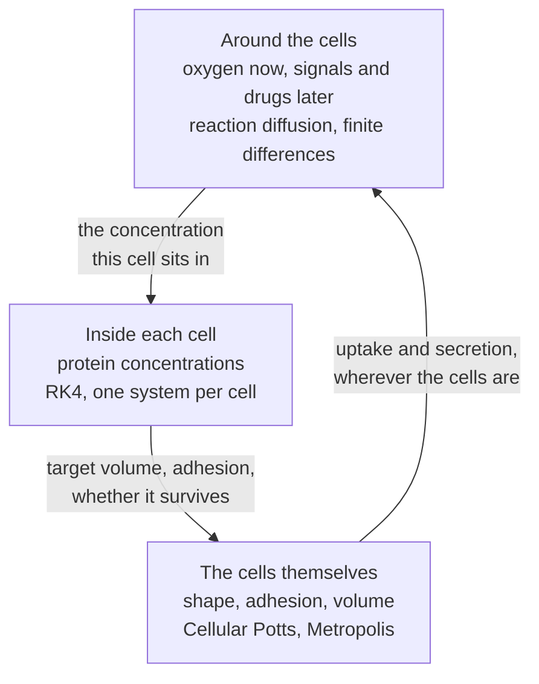
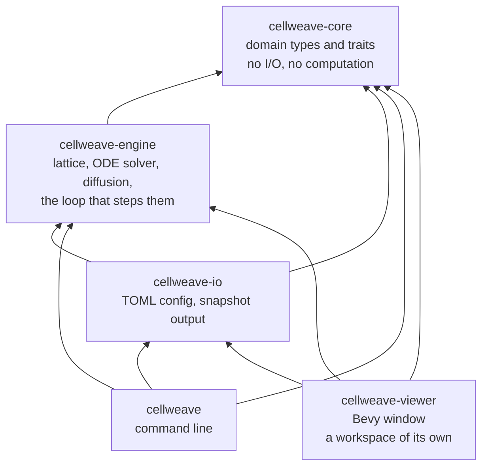

# cellweave

[](https://github.com/ngodzik/cellweave/actions/workflows/ci.yml) [](https://github.com/ngodzik/cellweave/actions/workflows/security.yml)

**cellweave runs a molecular hypothesis inside every cell, and shows what it does to the tissue.**

## What that means

A *molecular hypothesis* is a claim about biology: which proteins act on which, in which direction, and how fast. For example, low oxygen raises HIF-1a, HIF-1a raises BCL2, and BCL2 keeps the cell alive. Stated in words it sounds plausible. Written as equations it becomes something you can run.

A *tissue* here is not a sheet of paper. It is a population of cells sitting next to each other, pushing on each other, and sharing whatever diffuses between them.

So the program takes a hypothesis stated at the scale of molecules inside one cell, gives a copy of it to every cell in the population, lets the cells consume and release into the space around them, and reports what the whole population ends up doing. The question it answers is not "is this protein important" but "if this network is what is really inside each cell, what shape does the tissue take".

## Why

Going from data to a therapeutic target today is largely statistical association: this gene correlates with that outcome. What sits between the two, and is hard to get at, is the mechanism. A simulation is one way to state a mechanism precisely enough that it can be wrong.

It also does something an experiment cannot. It runs the counterfactual: the same population, the same random seed, one parameter changed, so the difference between the two runs is attributable to that parameter and to nothing else. And it can be searched, which means asking not only whether a hypothesis holds but which interventions on it produce a tissue that behaves differently.

Nothing here is validated, and none of it substitutes for an experiment. The output of a run is a hypothesis worth testing, never a result.

## How it works

Three scales, coupled, in one program:

- **The cells.** A Cellular Potts model on a lattice, where a cell is a set of pixels rather than a point. Cells have a shape, a surface, and neighbours they adhere to more or less strongly.
- **Inside each cell.** A small system of ordinary differential equations over protein concentrations, integrated per cell. Each cell carries its own state.
- **Around the cells.** Reaction diffusion fields for what moves through the space between cells, oxygen first.

The loop is the whole point. Cells change the environment that then decides their fate, so what the tissue does is not written anywhere in the code. All three arrows are wired for oxygen; what each still lacks is in [What does not work yet](#what-does-not-work-yet).



Behaviour has to follow from that model rather than from hardcoded rules. A cell grows, loosens its grip on its neighbours, or dies because its internal state says so, not because a flag was set. A necrotic core, if one appears, has to appear because the cells in the middle ran out of oxygen, not because the code drew a circle.

## Status

Early-stage personal project. Not production software, and not scientifically validated.

I am a software engineer, not a biologist. I started this to learn multiscale modelling by implementing it. I use AI assistance to write code faster and to pick up Rust idioms along the way, and I review and own everything here, mistakes included.

Mature, validated tools already exist for this kind of work. If you need results today, use CompuCell3D, Morpheus, PhysiCell or PhysiBoSS instead. cellweave overlaps with them by design, because reimplementing established methods is the point of the exercise. What differs is the engineering: Rust, a single binary, reproducible TOML configs.

Features will be added progressively, and this README will follow as they land.

## What works today

- Builds clean, `cargo clippy -D warnings` passes, 78 tests green
- 2D lattice with Monte Carlo spin flips and a volume constraint, with the boundary term pinned by four tests whose values are computable by hand
- **The protein network is a file, not code.** Any number of proteins, any topology, each declared with the terms that move it, drawn from a closed catalogue named after what each means in biology. The file also says which node answers which question the simulation asks a cell, and how growth becomes a demand on the lattice. So stating a different hypothesis is writing a different file, and two files under the same seed differ by exactly what you changed. The RAS/ERK network that used to be literals in the source is now `examples/networks/ras-erk.toml`, compiled in as the default so that the built-in hypothesis and one you write go through the same path; a test pins that the two produce identical trajectories to twelve decimals
- RK4 integration per cell, whose growth node sets how large its cell tries to be. This is the upward half of the coupling, protein state driving mechanics
- Cell division: a cell that grows past a threshold splits along a line through its centre of mass, and the daughter inherits a copy of the parent's network. One cell becomes a population
- The downward half of the coupling: every lattice step, the oxygen field is relaxed to its steady state against the current layout of the cells, living cells take up oxygen where they sit, and each cell reads the mean over its own pixels into its network. Three clocks, field, network and cell cycle, are kept in the order biology has them, and a test pins the network's response time
- Three fates from that reading: a cell proliferates, or goes quiescent when its hypoxia response is high, or dies when its survival signal collapses below the anoxia threshold. A necrotic cell holds its shape and stops consuming
- Two geometries, chosen in the configuration. In a **bath**, the medium around the tissue is held at full oxygen and a single cell grows into a spheroid that starves from the inside: a necrotic core appears without any rule placing it there, at the same size on a 200 and a 300 pixel grid. The run stops, and says so, the moment tissue touches the edge of the box. Around a **vessel**, an obstacle held at full oxygen with consuming stroma all around, the tissue grows into a tumour cord: living out to the depth diffusion can feed, dead beyond, the classic geometry of tumour hypoxia
- Dead cells are resorbed, giving up their pixels over a few dozen steps until nothing is left. In the cord that makes births balance deaths: about forty living cells, one born every three steps, the same one dying, for as long as the run lasts, without ever nearing the edge of the box. That steady turnover is what an evolving population needs, and what a growing spheroid cannot offer
- A diffusion field solved to its steady state every lattice step by projected successive over-relaxation in red-black order, spread over every core, since oxygen equilibrates far faster than anything a cell does. Time stepping is kept for what needs it and refuses a step the explicit scheme cannot take. The field reproduces the closed-form profile of a bathed disc
- TOML configuration, JSON snapshot output per saved step
- **A run measures itself.** Every step writes a row of `measurements.csv`: cells in each fate, born and resorbed, and the shape of the tissue as equivalent radii, how large the necrotic area is and how deep living tissue reaches from its oxygen supply. The run ends with a summary of the same, so two hypotheses are compared on numbers rather than by squinting at snapshots
- A viewer, in a workspace of its own, that runs the same loop under the same seed and draws the tissue as it grows: each cell lit by its fate, a protein, or the oxygen it sits in, with the population and the shape of the tissue plotted alongside. See [Watching a run](#watching-a-run)
- CLI entry point, a thin driver over `Simulation`, the loop itself, which lives in the engine so that anything else that runs a simulation runs the same one

## What does not work yet

Listed plainly, because a green test suite is not the same thing as correct physics.

- **Only oxygen is coupled.** Growth factor is still a hardcoded input the same for every cell, and nothing is secreted, so VEGF is computed and goes nowhere.
- **Only the field is parallel.** Solving it was the dominant cost and now runs on every core, the same to the last bit whatever their number: the cord runs about six times faster on a twenty-thread machine. The Monte Carlo step, which moves the pixels, still runs on one, because it draws from a single random sequence and splitting it would change which run a seed names.
- **No evolution.** Daughters are exact copies. Nothing varies, so nothing is selected.
- **No calibration.** Every constant is a placeholder, and no unit of length or time has been fixed. The uptake rate is now a configuration value, but its two example values were chosen to make each geometry show its structure, not measured against anything.

## Building and running

Requires Rust 1.97 or newer, which is the minimum CI builds against.

```bash
cargo build --release
cargo test --workspace

# A spheroid in a bath, the default: one cell, 200x200, stops at the edge
./target/release/cellweave --config examples/spheroid.toml

# A tumour cord around a vessel: steady turnover, runs as long as asked
./target/release/cellweave --config examples/cord.toml --mcs 3000
```

Snapshots are written as `output/snapshot_NNNNNN.json`, one per interval, listing every living cell with its kind, volume, protein state and the oxygen it sits in. Next to them, `measurements.csv` holds one row per step of the numbers a tissue is judged on (chapter 5 of the course says what each means). Two runs of the same configuration produce byte-identical output, and CI checks that they still do, for both geometries.

## Watching a run

The viewer draws the tissue live, in a window, with [Bevy](https://bevyengine.org). It is a separate Cargo workspace in `viewer/`, so the simulator never compiles, links or needs anything graphical: `cargo build` at the root builds no window, and the viewer is only built when asked for.

```bash
cd viewer
cargo run --release -- --config ../examples/cord.toml
```

On Linux it needs the Wayland and xkbcommon development headers (`libwayland-dev` and `libxkbcommon-dev` on Debian and Ubuntu).

It runs the same `Simulation` as the command line, under the same seed, so step 300 in the window is step 300 in the snapshots. Each cell is filled by what it is doing, cycling, quiescent or necrotic, by the level of one protein, or by the oxygen it sits in, and outlined where it meets another. The panel counts the population and plots it, and plots the viable depth and the necrotic radius from the same measurements the command line writes. Space pauses, N takes one step, R restarts, the mouse turns and zooms the camera.

## Checks

What every push is held to, all of it runnable locally:

```bash
cargo fmt --all -- --check
cargo clippy --workspace --all-targets -- -D warnings
cargo test --workspace
RUSTDOCFLAGS="-D warnings" cargo doc --workspace --no-deps
```

On top of that, CI builds on three platforms, holds the minimum toolchain, and checks the one property the compiler cannot see: that the same seed produces the same run, byte for byte. Without that, no result can be attributed to the change that was made rather than to the noise.


`cargo-deny` runs on a schedule as well as on a push, because an advisory published against a crate that has been in `Cargo.lock` for months arrives with no push at all.

## Architecture

Separation between layers is enforced by the crate dependency graph, so the compiler rejects inverted dependencies rather than relying on convention.



An arrow reads "depends on". Cargo refuses the reverse, so a layering mistake is a build failure rather than something a reviewer has to catch. The viewer sits on top of everything and nothing depends on it; being a separate workspace, it cannot leak a graphics dependency into the simulator even by accident.

There is no AI or MCP dependency inside cellweave. External tools connect through the CLI. See [CLAUDE.md](CLAUDE.md) for coding rules.

## The course

[docs/](docs/README.md) explains what the program simulates from the biology up: what each thing is in the body, what cellweave makes of it, which choices were made and why, where in the code it lives, and what is still a placeholder. It is kept in step with the code: a change to the model is not finished until the chapter that describes it says the new thing.

## License

MIT. See [LICENSE](LICENSE).
