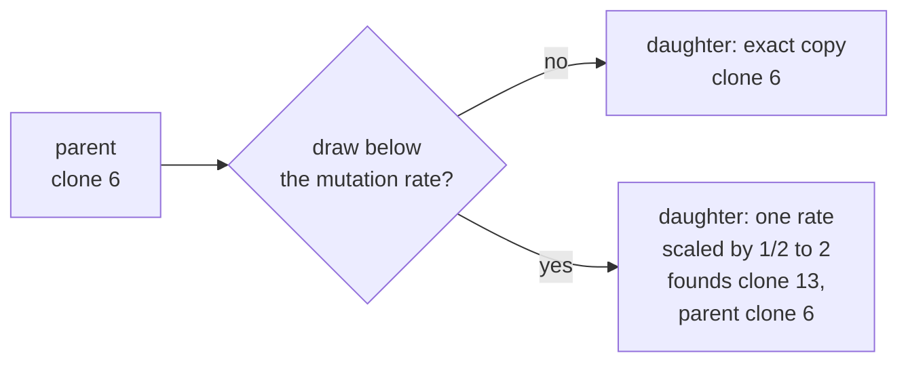

# 6. A population that evolves

Daughters that are not quite copies, and what selection makes of them when nobody says what to select.

## In the body

A tumour is not one cell type. It is a population descended from one cell, and every division copies a genome of three billion letters with a few mistakes. Most mistakes change nothing. Some change how much of a protein the cell makes, or how strongly a protein acts. A **mutation** is such a heritable change: the daughter carries it, and so does every cell descended from her.

The cells descended from one mutated ancestor, with no further mutation in between, form a **clone**. A tumour is a patchwork of clones, and they compete: for space, for oxygen, for the room near a vessel. A clone whose cells divide where others stop, or survive where others die, leaves more descendants. That is **selection**, and it needs nothing more than variation, heredity and a difference in how many offspring each variant leaves. Nobody chooses the winner. The environment does, by being what it is.

When one clone outcompetes the rest and takes over the population, that is a **clonal sweep**. Sweeps are how a tumour acquires its hallmarks one at a time: each is a mutation that happened to pay off in the place where it arose. One of the best documented is escape from hypoxia: cells that keep dividing where oxygen is too low for their ancestors to do so.

Two things matter as much as selection and are easy to forget. A mutation can spread with no advantage at all, because it arose in a cell that was in a good place, or because it rode along in a lineage that later picked up a good one: that is **drift** and **hitchhiking**. And a mutation that would help can vanish, because the one cell that carried it happened to be pushed into the necrotic zone before dividing.

## In cellweave

Each division may change the daughter's network. With a probability the configuration sets, the **mutation rate**, the daughter's copy has one rate scaled: one term of one node, chosen uniformly among all the terms the network file declares, multiplied by a factor between one half and two. The daughter founds a new clone, numbered in the order clones arise, and remembers which clone it arose in.

Nothing else is new. A mutated network runs through exactly the same loop as every other: it reads its oxygen, its proteins move, its growth node sets its size, its hypoxia response and its survival decide its fate (chapter 4). Whether the change helps is decided there, by the same thresholds as for everyone, in whatever place the cell happens to be.

### What seed 42 found

`examples/cord-evolving.toml` is the cord of chapter 5 with a mutation rate of one in twenty. For the first 1700 steps it looks like the cord: about forty living cells, a quiescent ring, a steady depth. Clones come and go, and the founder is gone by step 400.

The lineage that takes over picks up six mutations, and the first five leave the cord as it was: the quiescent ring holds, and so does the depth. Two change VEGF (vascular endothelial growth factor, the call for new vessels), which goes nowhere in this model: those are neutral by construction, and they spread anyway, because they arose near the vessel. That is hitchhiking, on the screen. The sixth, at step 1720, weakens how strongly HIF-1α (hypoxia-inducible factor 1 alpha, the protein that accumulates as oxygen falls) is switched on by the lack of oxygen, to 0.66 of its rate. Cells of that clone reach the quiescence threshold of chapter 4 only deeper in the tissue, so they keep dividing where their cousins stop.

Over the next three hundred steps the quiescent cells disappear: from 26 at step 1700 to 1 at step 2000, with the cycling ones going from 18 to 44. A daughter clone that also makes HIF-1α decay twice as fast spreads inside the first. With nothing arresting division, the cord no longer holds its thickness. Births outrun deaths, the tissue grows outward, and at step 2451 it touches the edge of the box and the run stops. By then 68 clones have been founded and 10 are alive.

Nobody wrote "escape hypoxic arrest". There is no rule about it, no fitness function, no target. It is the one change, among sixty-eight tried, that paid off in a tissue whose limit was hypoxic arrest.

### Across seeds

One history proves little, so the same configuration was run under seeds 1 to 8, with `--seed`, for 3000 steps each. The prediction, written before the runs, was that in at least five of the eight the leading clone would carry a weakened hypoxia response and the quiescent cells would be nearly gone (fewer than five).

That held in four: seeds 2, 3, 5 and 7, each through a different HIF-1α change (switched on more weakly, or decaying faster). Seed 8 found the same kind of mutation but kept fifteen quiescent cells, so the prediction failed, narrowly. The larger finding is that seven of the eight cords left their steady state one way or another, by routes that differ:

| seed | what the leading clone changed | at the end |
|---|---|---|
| 1 | ERK decays at 0.54 of its rate, so it stays higher | touched the edge at step 1056, 54 quiescent |
| 2 | HIF-1α switched on at 0.69 | 42 cycling, 3 quiescent |
| 3 | HIF-1α switched on at 0.56 | touched the edge at step 2748, 1 quiescent |
| 4 | BCL2 damaged at 0.52 of its rate below the anoxia threshold | touched the edge at step 2472, 68 quiescent |
| 5 | HIF-1α decays at 1.97 | 43 cycling, 0 quiescent |
| 6 | a small change to BCL2 | steady, like the cord without mutation |
| 7 | HIF-1α decays at 1.49 | touched the edge at step 1482, 0 quiescent |
| 8 | HIF-1α switched on at 0.73 | 50 cycling, 15 quiescent |

Escaping arrest is the most common route but not the only one: surviving deeper (seed 4) or growing more (seed 1) also breaks the balance. In biology this is **convergent evolution**: the same outcome, a tumour that outgrows its steady state, reached through different changes.

### Watching it

In the viewer, colour by **clone**. The founder is a muted blue and every mutant a hue of its own, dimmed while arrested, so a clone that escapes arrest is also a clone that lights up. The panel lists the leading clones with the mutation that founded each, and plots every clone's share of the living over time, stacked: a **Muller plot**, where a sweep is a band that widens until it pushes the others out.

## Choices, and why

**Only rates mutate, never the shape of the network.** A mutation scales how strongly a term acts; it does not add a node, remove one, or rewire who activates whom. That is what most point mutations do to a protein, turn its activity up or down, and it keeps every mutant a variation on the hypothesis written in the file rather than a different hypothesis.

**Every term is equally likely.** BCL2 (B-cell lymphoma 2, the survival protein) has four terms and RAS has two, so BCL2 is hit twice as often. That is a statement about the file, not about biology, and it is easy to see in the 68 clones: 25 hit BCL2, 13 RAS, 12 HIF-1α, 10 VEGF, 7 ERK (extracellular signal-regulated kinase, the growth relay).

**Large effects.** A factor between one half and two, uniform in its logarithm so that halving is as likely as doubling. Small effects are more realistic and invisible: a change of a percent drowns in the noise of the lattice, and selection cannot act on what makes no difference to fate.

**No mutation, no draw.** A run with a mutation rate of zero draws nothing extra from the generator, so it is the same run, step for step, that it was before mutation existed. Measurements and snapshots match the previous version exactly, the snapshot only gaining the clone of each cell. Turning mutation on does change the run from the first division on, since the draws shift everything after them.

**A clone is a number and a parent.** Not a genome, not a list of differences from the founder. The chain back to the founder holds every mutation, and `clones.json` writes it out.

## Where in the code

`crates/engine/src/network.rs`: `Network::mutate`, which picks a term and scales its rate, `Mutation`, what changed, and `MUTATION_SPREAD`, the factor's bound.

`crates/engine/src/evolution.rs`: `CloneRecord`, a clone's parent, birth step and founding mutation; `Simulation::clone_sizes`, the living cells per clone.

`crates/engine/src/simulation.rs`: `divide_ready_cells` draws, mutates and founds; `Scenario::mutation_rate` is the probability; `clone_of` and `clones` read the lineage back.

`crates/core/src/types.rs`: `CloneId`, which every cell in a snapshot now carries.

`crates/io/src/output.rs`: `write_clones`, which writes `clones.json` at the end of a run. The command line then names the leading clones with their chain of mutations.

`viewer/src/panel.rs` and `viewer/src/paint.rs`: the clone colouring and the Muller plot.

## Still a placeholder

The mutation rate: one in twenty divisions, where a real one is nearer one change per gene in a billion. It compresses years into a few thousand steps, and the order in which things happen is all it preserves. The factor's range, the uniform choice of term, and the absence of any mutation that changes a threshold, a contact energy, or the shape of a cell. And the tissue itself: one geometry, nine seeds. Nine histories say which routes exist; how often each is taken needs many more, and a statistic over them that the program does not yet compute.
