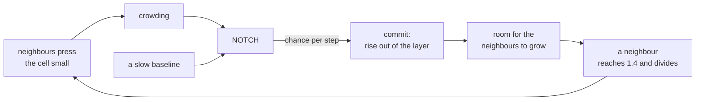

# 7. A tissue that holds its size

Normal tissue, before any tumour: a layer that renews itself, clones that win and lose by chance, and mutants that take over without anything looking wrong.

## In the body

The lining of the oesophagus, like the skin, is an **epithelium**: sheets of cells stacked in layers. Only the bottom one, the **basal layer**, divides. When a basal cell commits to **differentiate**, it stops dividing and moves up, out of the basal layer, towards the surface where it is eventually shed. Every day the basal layer loses cells upwards and replaces them by division, and its size does not change: births balance departures.

Which cells divide and which leave is largely chance. Follow every basal cell and its descendants, which is what a **lineage tracing** experiment does by marking cells with a heritable colour, and most lines die out, because all their cells happened to leave, while the survivors grow to fill the space. With no cell better than another, the number of surviving clones keeps falling and their average size keeps growing. This is **neutral drift**. Snippert and colleagues saw it in the crypts of the intestine (Cell, 2010): every crypt ends up held by the descendants of a single stem cell.

Then came a surprise from sequencing. Martincorena and colleagues looked at the oesophagus of people without cancer (Science, 2018) and found it, by middle age, largely covered by clones carrying mutations in genes known from cancer, some of them more common in the normal tissue than in oesophageal cancers. The tissue looked normal. Colom and colleagues then showed (Nature Genetics, 2020) that mutant clones expand until they meet other mutant clones, and that this collision is what slows them: **competition for space**.

One gene stands out in both: **NOTCH1**, a receptor that in these epithelia pushes a basal cell to differentiate. A clone that has lost it differentiates less and leaves fewer of its cells to go upwards, so it keeps more of them in the basal layer and grows.

## In cellweave

Three things are new, and nothing else changes.

**A sheet.** Instead of one cell, the box is tiled with square cells of normal tissue, 400 of them on the default grid, and each one is the founder of its own clone. That is lineage tracing from the start: every cell marked, every clone followed. There is no oxygen to speak of; a sheet leaves no medium for a supply, so the field is off and every cell reads full oxygen. The box must hold a whole number of cells on each side, since a cell clipped by the edge would read as crowded from the first step, and a sheet cannot be laid around a vessel; both are refused when the run is built.

**Crowding.** A cell reads, besides oxygen and EGF (epidermal growth factor, the growth signal of chapter 2), how squeezed it is: how far below the size it was born to it sits, as a fraction of it. A cell pressed small by its neighbours reads a high crowding. It is the signal behind **contact inhibition**: a cell with no room stops behaving like one with room.

**Differentiation.** A network may name a node as its differentiation role. The level of that node is the cell's chance, each step, of committing to differentiate. A committed cell stops running its network, rises out of the layer and gives up its pixels, six per step, until it is gone. The shipped network `examples/networks/epithelium.toml` is the RAS/ERK network of chapter 2 with one node added, NOTCH, held near 0.01 so that about one cell in a hundred commits each step, and pushed higher by crowding.

That loop is the whole of the regulation. No step counts cells or holds the layer at a size. A crowded patch thins itself by differentiating; a gap fills by growth and division. The cells decide when to divide as in chapter 4, by reaching 1.4 times their reference size, which in a full layer they can only do when a neighbour leaves. A sheet checks for division at every step rather than every twenty, since checking in batches made the whole layer divide in waves.

### Holding its size, and drifting

`examples/epithelium.toml` runs the sheet without mutation for 3000 steps. From step 1500 on, the layer holds between 281 and 328 cells, averaging 296, while making and losing about three cells per step: it is renewed many times over without changing size.

And the clones drift. With no cell better than any other, the clones still in the layer fall from 393 at the start to 98 at step 300, 50 at step 600, 27 at step 1200 and 11 at step 2700. Neutral drift on the screen: in the viewer, coloured by clone, the patchwork coarsens as some patches vanish and others spread, with nothing distinguishing the winners.

### Ageing: mutant clones that take over

`examples/epithelium-mutating.toml` is the same sheet for 6000 steps with one division in a hundred mutated. The prediction, from the biology above, was that clones turning NOTCH down would take over.

They did not. What took over, again and again, were clones that turn the growth pathway up: RAS switched on more strongly, ERK decaying more slowly. Each sweep arose inside the previous winner and added one more such change:

| step | leading clone, by its latest mutation | share of the layer |
|---|---|---|
| 500 | ERK switched on at 1.88 | 85% |
| 1500 | ERK decays at 0.63, inside the clone above | 35% |
| 2000 | RAS switched on at 1.67, inside the clone above | 94% |
| 3500 | ERK decays at 0.69, further down the same line | 82% |
| 5500 | RAS decays at 0.51, further down the same line | 91% |

The best a NOTCH-lowering clone did was 46 cells, about a sixth of the layer, before it was lost.

The reason is mechanical. Higher ERK raises the size a cell tries to reach (chapter 2), so it presses harder on its neighbours; they are squeezed, read a higher crowding, and differentiate first. The pushing cell wins the space they leave. Nobody wrote that rule: it is **cell competition**, out of the volume constraint of chapter 1 and the crowding signal. Lowering NOTCH helps a clone too, but by at most a factor of two on a small chance, and that is weaker than pressing a neighbour out.

One thing matches the oesophagus. The layer holds its size throughout, 288 to 310 cells at every point sampled, while one mutant clone after another takes it over: a tissue colonised by mutants that looks normal. Whether a clone here slows when it meets another mutant clone, as Colom and colleagues saw, has not been measured yet; it needs clone sizes followed over time, which the program does not report.

One thing does not. In the real oesophagus the most successful clones carry NOTCH1 and TP53 mutations, not mutations of the growth pathway. So this version of the model makes a claim that the sequencing contradicts: if basal cells competed by pressing on each other, growth mutants would win. Either they do not compete that way, or a loss of NOTCH1 does far more than halve a baseline. Saying which is a hypothesis the model can now test, by changing one file.

### Watching it

`cargo run --release -- --config ../examples/epithelium-mutating.toml --view clone` in `viewer/`. Every founder has a hue; cells leaving the layer rise out of it, dimmed; a newborn flashes for a few steps. The Muller plot of chapter 6 shows the sweeps as bands replacing each other. In the fate view, cells leaving are pale, cells dividing teal.

## Choices, and why

**Crowding as a cell's own size.** A cell cannot count its neighbours, but it can sense how spread it is, which is how contact inhibition is understood to work in an epithelium. Measured against the lineage's reference volume rather than against the size the cell is trying to reach, so that a cell growing larger does not read as less crowded for that alone.

**A chance, not a threshold.** Survival and quiescence are thresholds (chapter 4); differentiation is a probability per step. Which basal cell leaves is, as far as the experiments can tell, chance, and a threshold would make every cell in the same state leave at the same step. The chance is drawn only for a network that names the role, so a tumour network takes exactly the draws it took before, and every tumour run is unchanged to the byte.

**Leaving upwards, shown as rising.** The model is the basal layer alone, flat. A committed cell gives up its pixels at six per step, faster than a dead cell is resorbed, because leaving is something a living cell does. The viewer raises it out of the surface, which is the direction it goes in the body.

**The field is off.** With nothing consuming, every pixel would sit at the supply's level anyway, so the field is not solved at all. That is also why a sheet runs fast: 6000 steps in about forty seconds.

**Every cell its own clone.** Lineage tracing in the laboratory labels a fraction of cells; labelling all of them is the limit of the same experiment, and it is what makes the neutral drift readable from the clone count alone.

## Where in the code

`crates/core/src/types.rs`: `Seeding`, one cell or a sheet; `CellKind::Differentiated`; the `crowding` field of `CellInputs`.

`crates/core/src/network.rs`: `crowding` among `INPUT_NAMES`; the `differentiation` field of `Roles`.

`crates/engine/src/simulation.rs`: the sheet seeding in `Simulation::new`; `crowding`, the signal; the draw against `Network::differentiation` in `step`; `SHEDDING_RATE`; `Fate::Differentiating`; `field_is_off`.

`crates/engine/src/cpm.rs`: `add_block`, the square cells a sheet is tiled with.

`crates/io/tests/epithelium.rs`: that a sheet fills the box with one clone per cell, holds its size while turning over, loses clones by chance alone, and that a committed cell leaves.

`examples/networks/epithelium.toml`, `examples/epithelium.toml`, `examples/epithelium-mutating.toml`.

## Still a placeholder

All of NOTCH's rates, the crowding curve, the shedding rate, and the size of the cells; the mutation rate, a hundred times below the evolving cord's and still far above a real one. The layer is one layer, seen from above, with nothing above it and no wound in it; the papers this chapter cites measured clone sizes over a year of a mouse's life and in decades of a human's, and comparing the clone size distributions they publish to the model's is what would turn this chapter's qualitative agreement into a quantitative one. That needs the units of chapter 8.
