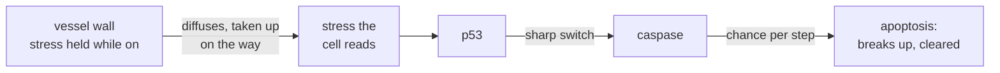

# 8. A lethal stress

A second way to die, the one a cell carries out itself, and an agent from outside that sets it off where it reaches.

**Calibrated since.** Chapter 25 fixed the tumour's oxygen uptake on measured melanoma spheroids at 0.00002, where this chapter's runs used 0.00003. The mechanisms are the same; the shipped examples now run at the calibrated value, and rerunning them gives other numbers than those quoted here.

## In the body

Necrosis, the death of chapter 4, is a failure: a cell runs out of energy, swells, bursts, and leaves debris that lingers. **Apoptosis** is the other way to die, and it is a programme. A cell that judges itself damaged beyond repair takes itself apart in order: it shrinks, packs its contents into small fragments wrapped in membrane, and its neighbours swallow them within hours. Nothing spills, and the tissue barely notices.

The judge is **p53**, a protein that rises when a cell is damaged, its DNA above all. Low, it pauses the cell while repairs are attempted; high and lasting, it switches on the machinery of apoptosis. The executioners are the **caspases**, enzymes that, once active, cut the cell's own proteins apart. The switch from repair to death is sharp: below some level of damage nothing happens, above it apoptosis follows.

Agents that damage cells come from outside, and in a tissue they come in the way everything does, from the blood, through the vessel wall, spreading between the cells and taken up by those they reach. So they do not reach everyone equally. Cells against the vessel get the most; cells far out, short of oxygen and mostly not dividing, get the least.

## In cellweave

The **lethal stress** is an abstract agent, not a model of anything in particular. It is a second field, solved the way oxygen is (chapter 3): held at its source, spreading by diffusion, taken up by every living cell at a rate the configuration states. Its source is where oxygen comes in, the vessel wall or the bath, so it reaches the tissue along the same paths and is used up on the way.

An **exposure** in the configuration switches it on:

```toml
[exposure]
intensity = 1.0     # level held at the source while on
uptake = 0.0001     # what each living pixel takes up; the higher, the shorter its reach
start = 800         # first step on
schedule = { kind = "periodic", on = 150, off = 350 }   # or { kind = "continuous" }
```

While exposure is off, nothing supplies the field and it is zero everywhere. Each cell reads the mean over its own pixels as a new network input, `stress`, beside `oxygen`, `egf` and `crowding`.

What the stress does is the network's business. `examples/networks/stress-response.toml` adds two nodes to the RAS/ERK network: p53, switched on by the stress, and caspase, switched on sharply by p53 (a Hill response, half way at p53 of 0.4). A network may name a node as its **apoptosis** role, and that node's level is the cell's chance, each step, of starting apoptosis, as the differentiation node of chapter 7 is a chance of leaving the layer. A cell that starts apoptosis stops its network, stops taking up oxygen or stress, and gives up its pixels at eight per step, faster than a necrotic cell is resorbed, until it is gone.



### What the cord does under it

`examples/cord-stress.toml` is the cord of chapter 5 exposed continuously from step 800. Before, it holds 46 living cells. Then:

| step | living cells |
|---|---|
| 800 | 46 |
| 900 | 31 |
| 1000 | 27 |
| 1200 | 15 |
| 1400 | 7 |
| 1600 to 2000 | 6 |
| 2300 | 3 |

The cells that die are the ones against the vessel: the cycling ones, which the stress reaches first and hardest. The survivors are out at the edge of the living tissue: at step 1550 the six left sit in 10 to 23 percent of the vessel's oxygen, every one of them quiescent (HIF-1α between 0.48 and 0.52), and every one reading so little stress that its p53 stays below 0.09. Nobody wrote "hide in the hypoxic zone". The stress is used up by the cells it reaches first, and those far out, the ones the shortage of oxygen had already stopped, are the ones it never reaches. That is a **refuge**, and it is the same geometry that made the cord in the first place.

`examples/cord-stress-periodic.toml` switches the same stress on for 150 steps in every 500. Each time it comes on, the cord falls to 31 to 34 living cells; each time it goes off, it grows back to 47 or 48 before the next exposure, from the refuge and from what survived against the vessel. The two runs differ by one line, the schedule.

### Watching it

In the viewer a cell in apoptosis is violet, sinks and crumbles, and flares violet when it starts. The medium takes on a violet haze where the stress reaches. Colour by **stress** to see its field, hot at the vessel and dark at the refuge; the population plot shades every stretch the stress was on, so a fall and a recovery read against what caused them.

## Choices, and why

**An abstract stress, not a substance.** The field has a source level, a reach set by its uptake, and an effect set by the network file. That is enough to ask how a population that varies, in a space where the stress does not reach everyone equally, responds to it, and it claims nothing more.

**The same diffusion as oxygen.** How far each field reaches is then set by its uptake alone, so the difference between the two is one number, stated in the configuration.

**A chance per step, drawn only where the role is named.** As with differentiation: a threshold would make every cell in the same state die at the same step. A network without an apoptosis role draws nothing, so every run written before this chapter is the same run, byte for byte.

**Solved again from scratch when the level changes.** Switching on starts the field from zero, and the per-step tolerance that keeps an equilibrium settled would let a slow front creep on unnoticed, as chapter 5 found with the oxygen. Each change of level is solved as tightly as the oxygen at the start.

**Only where oxygen comes in.** A sheet runs with the field off (chapter 7) and has no source for a stress either; an exposure on a sheet is refused.

## Where in the code

`crates/core/src/types.rs`: `Exposure`, `Schedule`, `Exposure::level_at`, `CellKind::Apoptotic`, the `stress` field of `CellInputs`.

`crates/core/src/network.rs`: `stress` among `INPUT_NAMES`; the `apoptosis` field of `Roles`.

`crates/engine/src/simulation.rs`: `settle_stress`, which solves the field each step; the draw against `Network::apoptosis` in `step`; `FRAGMENTATION_RATE`; `STRESS_DIFFUSION`; `Fate::Apoptotic`.

`crates/engine/src/pde.rs`: `ScalarField::fill`, for the field while exposure is off.

`crates/io/tests/stress.rs`: that a schedule is on when it says, that there is no field without an exposure, that the stress is taken up on its way in and kills by apoptosis, that an apoptotic cell is cleared, and that an exposure which cannot settle is refused.

`examples/networks/stress-response.toml`, `examples/cord-stress.toml`, `examples/cord-stress-periodic.toml`.

## Still a placeholder

The intensity, the uptake, the rates of p53 and caspase, and the fragmentation rate. The stress damages a cycling and a quiescent cell alike; a damage that depends on whether the cell is dividing would make the refuge deeper still. And without mutation nothing can become resistant to it: what a population that varies does under it, continuous or intermittent, is the next question.
