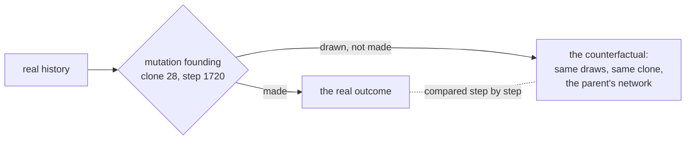

# 9. Rewinding a history

The same history replayed with one event taken out, everything else identical, to see which events made it and which only came along.

**Calibrated since.** Chapter 25 fixed the tumour's oxygen uptake on measured melanoma spheroids at 0.00002, where this chapter's runs used 0.00003. The mechanisms are the same; the shipped examples now run at the calibrated value, in a box of 300 pixels rather than 200, since at that uptake the tissue reached the edge of the smaller box within a few hundred steps, and rerunning them gives other numbers than those quoted here.

## In the body

A tumour carries many mutations, and most of them did nothing for it. A few are **drivers**: they gave the cell that carried them an advantage, and the tumour is what that advantage grew into. The rest are **passengers**: neutral changes that happened to arise in a cell that was going to win anyway, and were carried along with it. Telling the two apart is one of the central problems of cancer genomics, and it is done by statistics: a gene mutated across many tumours more often than chance would explain is a likely driver.

What no study of a real tumour can do is the direct test: take the tumour back to the moment a mutation arose, remove that one mutation, and let everything else happen again exactly as it did. That is a **counterfactual**, the history that would have been, and the difference between it and the real one is the mutation's effect and nothing else.

## In cellweave

A simulation can do it, if it is exactly reproducible, and this one is: the same configuration and seed give the same run to the last bit, whatever the number of threads (chapters 1 and 3).

A run may name clones to **suppress**. When the division that founds one of them comes, the mutation is drawn exactly as before, the same numbers taken from the generator in the same order, and the clone is founded with the same number, the same parent, the same first cell. Only the mutation is not made: the new clone's network is its parent's. Until that one difference changes what some cell does, the two runs are the same run. A mutation that never changes what any cell does leaves them the same to the end.

`cellweave --attribute` does it for a whole lineage. It runs the configuration once, takes the clone holding the most living cells at the end, walks back through the mutations that separate it from the founder, and runs the configuration again once per mutation with that one suppressed, all of them side by side on every core. For each it says whether the counterfactual is identical to the real history to the last bit (every measurement at every step and every pixel at the end), and if not, at which step the two parted and where the counterfactual ended. `--suppress 28,36` runs a single counterfactual and writes it out like any run.

### What seed 42's cord was made of

`cellweave --config examples/cord-evolving.toml --attribute` takes the evolving cord of chapter 6. In the real history the cord escapes hypoxic arrest and touches the edge of the box at step 2451, and the clone holding the most cells at the end, clone 28, carries six mutations. The prediction, written before the code: the two VEGF mutations (VEGF, vascular endothelial growth factor, is read by nothing in this configuration, whose vessel does not grow) have exactly no effect, and without the HIF-1α mutation the cord does not escape.

| suppressed | founded | mutation | the counterfactual |
|---|---|---|---|
| clone 1 | step 40 | VEGF made at 1.94 | **identical to the last bit** |
| clone 2 | step 280 | RAS switched on at 0.92 | parted at step 281; arrest lifted anyway (no quiescent cell at step 2999), the edge not reached |
| clone 6 | step 620 | VEGF lost at 0.95 | **identical to the last bit** |
| clone 13 | step 1020 | BCL2 made from ERK at 0.68 | parted at step 1133; no escape: 33 quiescent cells at step 2999 |
| clone 22 | step 1460 | RAS switched on at 1.30 | parted at step 1461; no escape: 22 quiescent |
| clone 28 | step 1720 | HIF-1α switched on at 0.66 | parted at step 1763; **no escape**: 28 quiescent, 7 cycling |

Both halves of the prediction held. The two VEGF mutations are **passengers**, and not by a statistical test: removing either leaves the history the same, every measurement at every step and every pixel at the end. They spread because they were in the winning line, nothing more. The HIF-1α mutation is a **driver**: without it, everything before step 1720 is the same history, the two part 43 steps later, once clone 28's cells start to behave differently, and the cord never escapes.

The other three need care, and the care is the point. Each parts the history *before* step 1720, and once two histories have parted, the numbers drawn after are drawn for a different tissue: the later mutations are not the same mutations. Rerunning those three counterfactuals and reading their clones shows what happened instead. Without clone 13 or clone 22, mutations of the same kind as the driver still arise, several of them (HIF-1α switched on at 0.59, 0.57, 0.67), and every one of them dies out; only one, in the history without clone 22 (HIF-1α lost 1.96 times as fast), still holds 7 cells at step 2999. Without clone 2, the arrest lifts anyway, through another lineage led by a change to BCL2. So these three are not shown to be drivers. What they show is that having the right mutation is not enough: it has to arise in a cell placed to win, at a time when it can, and the history decides that.

## Choices, and why

**Drawn, not made.** Suppressing a mutation by skipping its draws would shift every later random number, and the two runs would part at once for no reason that has to do with the mutation. Drawing it and discarding it keeps the generator in step, so the parting, when it comes, is the mutation's doing.

**The clone is still founded.** Its number, its parent and its cells are the ones it would have had, so the two runs can be compared clone by clone, and a suppressed clone is marked as such in `clones.json`, with the mutation it would have carried.

**Identical means identical.** Not close, not statistically indistinguishable: equal measurements at every step and equal ownership of every pixel at the end. That is a test no amount of noise can pass by accident, which is what makes "no effect" a finding rather than an absence of evidence.

**One mutation at a time.** Effects can combine: two mutations that each do nothing alone may matter together. Suppressing pairs is the same mechanism with two clones named, and is left for when a question asks for it.

## Where in the code

`crates/engine/src/simulation.rs`: `Scenario::suppress`, and the draw in `divide_ready_cells` that makes a suppressed mutation on a copy and keeps the daughter's network unchanged. `crates/engine/src/evolution.rs`: the `suppressed` field of `CloneRecord`.

`src/attribute.rs`: the real run, the lineage of the leading clone, the counterfactual runs in parallel and their comparison; `attribution.csv` is what it writes.

## Still a placeholder

Everything the evolving cord is built on (chapter 6): the mutation rate, the size of a mutation's effect, one geometry. And chaos: once two histories part, the lattice amplifies the difference, so how far apart they end is the mutation's effect and the lattice's sensitivity together. Whether they part at all is the mutation's alone.
