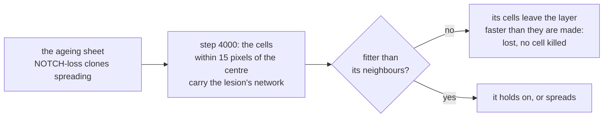

# 13. Purged by its neighbours

An early tumour arising in normal tissue that is already full of mutant clones, and whether those clones get rid of it.

## In the body

By middle age the lining of the oesophagus is a patchwork of mutant clones (chapters 7 and 11), many of them carrying mutations in genes known from cancer. Yet oesophageal cancer is rare. Colom and colleagues (Nature, 2021) asked what the mutant clones do to a tumour that starts among them.

They followed **early tumours**, microscopic patches of abnormal cells that had only just formed, in mice whose oesophagus had been given many mutations. Most of those tumours were soon gone. Their cells were not dying, not dividing more slowly, and not under attack by the immune system: they were being outcompeted. Making the clones around them more competitive made more tumours disappear; weakening competition made fewer disappear. And the tumours that did survive carried signs of selection. The conclusion: whether an early tumour survives depends on how fit it is compared with the mutant clones around it. The mutant clones of normal tissue, long read as the first steps towards cancer, also get rid of tumours.

What an early oesophageal tumour's cells do differently was measured by lineage tracing (Frede and colleagues, 2016, as reviewed by Alcolea, 2017): a moderate bias towards making dividing cells rather than differentiating ones, and no change in how often they divide.

## In cellweave

**A lesion.** A configuration may place one:

```toml
[lesion]
network = "networks/lesion.toml"   # what its cells carry, next to the configuration
at = 4000                          # the step it appears at
radius = 15.0                      # pixels around the centre of the box
```

At the start of step `at`, every living cell whose centre lies within `radius` pixels of the centre of the box starts carrying the lesion's network, fresh, and all of them join one new clone, marked `"lesion": true` in `clones.json`. Placing it draws nothing, so the run until then is the run without it. Only a sheet can hold one.

What makes it a tumour is only its network, which is all the question needs: whether its neighbours outcompete it. `examples/networks/lesion.toml` is the no-pressing epithelium of chapter 11 with NOTCH's baseline slowed to 0.7 of its rate: its cells leave the layer on their own about a third less often than normal cells, and divide no faster, the moderate bias of an early tumour. That makes it fitter than a normal cell and less fit than a cell that has lost NOTCH's baseline altogether, the clones that cover much of the ageing sheet of chapter 11.

**Following it.** `Simulation::lesion_cells` counts the living cells descended from the lesion, in its clone or any clone that arose in it, and `measurements.csv` has it as the `lesion` column, step by step. `Simulation::in_lesion` says whether a given cell is one of them. In the viewer, coloured by clone, the lesion's cells are a pale gold no clone's hue reaches, and the panel follows how many are left.



### One history

`examples/epithelium-lesion.toml` is the ageing sheet of chapter 11 in which neither assumption of chapter 7 holds (no pressing, a NOTCH term can be lost, one division in a hundred mutated). The lesion appears at step 4000, about 100 days in at chapter 12's 0.6 hours per step, over six cells, and is followed for 2000 steps more, about 50 days. Mutation goes on, in the lesion too.

Under the default seed:

| step | 4000 | 4200 | 4400 | 4600 | 4800 | 5000 | 6000 |
|---|---|---|---|---|---|---|---|
| lesion cells, ageing sheet | 6 | 7 | 2 | 1 | 1 | 0 | 0 |
| lesion cells, the same sheet with no mutation | 6 | 7 | 11 | 10 | 9 | 7 | 3 |

In the ageing sheet the lesion was gone at step 4866, about 22 days after it appeared. In a sheet that never mutated, the same lesion was still there 50 days on. As in the mice, nothing killed it: no cell died anywhere in the sheet in this history, and every lesion cell that went, left the layer by differentiating, a little faster than the lesion made new ones.

One history is an anecdote, and the two rows are not even the same history: without mutation the generator is drawn differently from the first division on. Whether the ageing sheet purges lesions as a rule is a question for many histories, paired (chapter 10).

## Choices, and why

**A lesion is placed, not evolved.** Waiting for a tumour to arise by mutation in the sheet would make its fitness, its place and its timing different in every history, and the question is about the neighbours. Placing one, with a fitness stated in a file, at a step and a place the configuration fixes, keeps the lesion the same and lets the tissue around it vary.

**Fresh, and one clone.** The lesion's cells start from the lesion network's initial levels, whatever they carried, and share one clone, so that everything descended from it can be followed, and what arose in it told apart from what it started as.

**Placed at the start of a step, drawing nothing.** A lesion that comes after the end of a run leaves the run identical to the one without it, which a test checks.

## Where in the code

`crates/engine/src/simulation.rs`: `Lesion`, the `lesion` field of `Scenario`, and where a step places it. `crates/engine/src/evolution.rs`: the `lesion` field of `CloneRecord`, `Simulation::lesion_cells`, `Simulation::in_lesion`. `crates/engine/src/measure.rs`: the `lesion` column. `crates/io/src/config.rs`: `LesionConfig`, read next to the configuration. `crates/io/tests/lesion.rs`: that a lesion turns the cells at the centre into one clone at its step and not before, that one which never comes changes nothing, and that it needs a sheet and some room.

`examples/networks/lesion.toml`, `examples/epithelium-lesion.toml`.

## Still a placeholder

The lesion's bias, 0.7 of NOTCH's baseline rate; its size and its place, the centre of the box; the step it appears at. A real early tumour is a three dimensional patch that grows up as well as across; this one is a patch of the basal layer and nothing else. And one history.
