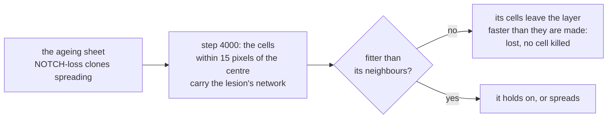

# 13. Purged by its neighbours

An early tumour arising in normal tissue that is already full of mutant clones, and whether those clones get rid of it.

## In the body

By middle age the lining of the oesophagus is a patchwork of mutant clones (chapters 7 and 11), many of them carrying mutations in genes known from cancer. Yet oesophageal cancer is rare. Colom and colleagues (Nature, 2021) asked what the mutant clones do to a tumour that starts among them.

They followed **early tumours**, microscopic patches of abnormal cells that had only just formed, in mice whose oesophagus had been given many mutations. Most of those tumours were soon gone. Their cells were not dying, not dividing more slowly, and not under attack by the immune system: they were being outcompeted. Making the clones around them more competitive made more tumours disappear; weakening competition made fewer disappear. And the tumours that did survive carried signs of selection. The conclusion: whether an early tumour survives depends on how fit it is compared with the mutant clones around it. The mutant clones of normal tissue, long read as the first steps towards cancer, also get rid of tumours.

What an early oesophageal tumour's cells do differently was measured by lineage tracing (Frede and colleagues, 2016, as reviewed by Alcolea, 2017): a moderate bias towards making dividing cells rather than differentiating ones, and no change in how often they divide.

## In cellweave

**A lesion.** A configuration may place one:

```toml
[lesion]
network = "networks/lesion.toml"   # what its cells carry, next to the configuration
at = 4000                          # the step it appears at
radius = 15.0                      # pixels around the centre of the box
```

At the start of step `at`, every living cell whose centre lies within `radius` pixels of the centre of the box starts carrying the lesion's network, fresh, and all of them join one new clone, marked `"lesion": true` in `clones.json`. Placing it draws nothing, so the run until then is the run without it. Only a sheet can hold one.

What makes it a tumour is only its network, which is all the question needs: whether its neighbours outcompete it. `examples/networks/lesion.toml` is the no-pressing epithelium of chapter 11 with NOTCH's baseline slowed to 0.7 of its rate: its cells leave the layer on their own about a third less often than normal cells, and divide no faster, the moderate bias of an early tumour. That makes it fitter than a normal cell and less fit than a cell that has lost NOTCH's baseline altogether, the clones that cover much of the ageing sheet of chapter 11.

**Following it.** `Simulation::lesion_cells` counts the living cells descended from the lesion, in its clone or any clone that arose in it, and `measurements.csv` has it as the `lesion` column, step by step. `Simulation::in_lesion` says whether a given cell is one of them. In the viewer, coloured by clone, the lesion's cells are a pale gold no clone's hue reaches, and the panel follows how many are left.



### One history

`examples/epithelium-lesion.toml` is the ageing sheet of chapter 11 in which neither assumption of chapter 7 holds (no pressing, a NOTCH term can be lost, one division in a hundred mutated). The lesion appears at step 4000, about 100 days in at chapter 12's 0.6 hours per step, over six cells, and is followed for 2000 steps more, about 50 days. Mutation goes on, in the lesion too.

Under the default seed:

| step | 4000 | 4200 | 4400 | 4600 | 4800 | 5000 | 6000 |
|---|---|---|---|---|---|---|---|
| lesion cells, ageing sheet | 6 | 7 | 2 | 1 | 1 | 0 | 0 |
| lesion cells, the same sheet with no mutation | 6 | 7 | 11 | 10 | 9 | 7 | 3 |

In the ageing sheet the lesion was gone at step 4866, about 22 days after it appeared. In a sheet that never mutated, the same lesion was still there 50 days on. As in the mice, nothing killed it: no cell died anywhere in the sheet in this history, and every lesion cell that went, left the layer by differentiating, a little faster than the lesion made new ones.

One history is an anecdote, and the two rows are not even the same history: without mutation the generator is drawn differently from the first division on. The next section shows this one was luck.

### Twenty histories, paired

For a fair comparison the clean sheet has to be the same history as the ageing one. A configuration may set `suppress_before`: every mutation founded before that step is drawn exactly as before and not made, the way chapter 9 suppresses one clone. `examples/epithelium-lesion-unmutated.toml` is `epithelium-lesion.toml` with `suppress_before = 4000`. Under one seed the two draw the same numbers: the same divisions, the same departures, the same lesion at the same step, everything but the mutant clones around it. Mutation goes on in both from step 4000. A campaign (chapter 10) now follows the lesion too: the cells left at the end, and the step it was lost at.

```bash
cellweave --config examples/epithelium-lesion.toml --seeds 1-20 --versus examples/epithelium-lesion-unmutated.toml
```

The predictions, written before any code: in the ageing sheet the lesion is lost by step 6000 in at least 12 seeds of 20, in the clean one in at most 6; paired, it ends smaller in the ageing sheet in at least 15; and where it is lost in the ageing sheet, it is lost within 1000 steps (about 25 days) in at least half the seeds, "most were rapidly lost".

**The main ones failed.** The lesion was lost in 16 seeds of 20 in the ageing sheet, and in 16 of 20 in the clean one too. Paired, it ended smaller in the ageing sheet in 3 seeds, larger in 4, and with nothing left in either in 13. Only the timing held: 15 of the 16 losses in the ageing sheet came within 1000 steps, against 10 of 16 in the clean one.

A lesion of six or seven cells that leaves the layer only a third less often than its neighbours is barely fitter than they are, and a clone that small, neutral or nearly so, is lost by chance most of the time whoever its neighbours are: neutral drift, as in chapter 7. So in this model most early tumours of this kind disappear without any competition at all. That is a second explanation for "most were rapidly lost", and Colom and colleagues' other experiments, making the neighbours more or less competitive, are what tells the two apart.

### How fit a lesion has to be

The model can run that experiment directly: keep the two sheets, change the lesion. Written after the first predictions failed and before anything else was run: in the clean sheet the lesion is lost less often as its bias strengthens, at most 8 of 20 at 0.3 of the baseline and at most 4 at none of it; at 0.3, the ageing sheet loses it in at least 4 more seeds than the clean one; and a lesion with no baseline at all, as fit as the fittest clones around it, is not purged by them.

`examples/networks/lesion-strong.toml` is the lesion at 0.3, run by `examples/epithelium-lesion-strong.toml` and `examples/epithelium-lesion-strong-unmutated.toml`; the rows at 0.5 and 0 are `lesion.toml` with NOTCH's baseline rate set to 0.0025 and to 0. Twenty paired seeds each, the sheets as above.

| NOTCH's baseline in the lesion | lost by step 6000, ageing sheet | lost, clean sheet | lesion cells at the end, ageing against clean (medians) |
|---|---|---|---|
| 0.7 of its rate | 16 of 20 | 16 of 20 | 0 against 0 |
| 0.5 | 15 | 2 | 0 against 17 |
| 0.3 | 12 | **0** | 0 against 24.5 |
| none | 0 | 0 | 7 against 85.5 |

All three held. There is a window. A lesion barely fitter than normal cells is lost by drift wherever it lands. A lesion fit enough to hold its own among normal cells, at 0.5 or 0.3, survives in the clean sheet almost every time and is lost in the ageing one most of the time: there, it is the mutant clones that remove it: the two runs of a pair draw the same numbers and differ by those clones and by what they did, nothing else. And a lesion as fit as the fittest clones around it is not removed by them, but it is held back: a median of 7 cells after 50 days among the mutants, 85 in the clean sheet, where it took over more than a quarter of the layer, much as Colom and colleagues (Nature Genetics, 2020) saw equally fit clones stop gaining once they meet.

That is Colom and colleagues' conclusion, reached in the model from the other side: whether an early tumour survives depends on its fitness relative to the clones around it, not on its fitness alone. And it adds what the mice could not show directly: the same lesion, in the same tissue with the same luck, survives or is lost depending only on whether the clones around it carry their mutations.

## Choices, and why

**A lesion is placed, not evolved.** Waiting for a tumour to arise by mutation in the sheet would make its fitness, its place and its timing different in every history, and the question is about the neighbours. Placing one, with a fitness stated in a file, at a step and a place the configuration fixes, keeps the lesion the same and lets the tissue around it vary.

**Fresh, and one clone.** The lesion's cells start from the lesion network's initial levels, whatever they carried, and share one clone, so that everything descended from it can be followed, and what arose in it told apart from what it started as.

**Placed at the start of a step, drawing nothing.** A lesion that comes after the end of a run leaves the run identical to the one without it, which a test checks.

**A clean sheet by suppression, not by a lower mutation rate.** Running the clean sheet with no mutation would draw different numbers from the first division on, and the two sheets would differ everywhere for reasons that have nothing to do with mutant clones. Drawn and not made, the mutations leave the sheet's luck alone.

**A second set of predictions, said to be one.** The first set failed, and the lesion's bias was then varied. That is the experiment the failure called for, and its predictions were written before it ran; the first lesion is kept as the one the chapter started with.

## Where in the code

`crates/engine/src/simulation.rs`: `Lesion`, the `lesion` field of `Scenario`, and where a step places it; `suppress_before`, read where a division founds a clone. `crates/engine/src/evolution.rs`: the `lesion` field of `CloneRecord`, `Simulation::lesion_cells`, `Simulation::in_lesion`. `crates/engine/src/measure.rs`: the `lesion` column. `crates/io/src/config.rs`: `LesionConfig`, read next to the configuration. `crates/io/tests/lesion.rs`: that a lesion turns the cells at the centre into one clone at its step and not before, that one which never comes changes nothing, and that it needs a sheet and some room.

`src/campaign.rs`: the `lesion` and `lesion_lost_at` columns of `campaign.csv`, and the lesion's line in the summary and the pairs.

`examples/networks/lesion.toml`, `examples/networks/lesion-strong.toml`, `examples/epithelium-lesion.toml`, `examples/epithelium-lesion-unmutated.toml`, `examples/epithelium-lesion-strong.toml`, `examples/epithelium-lesion-strong-unmutated.toml`.

## Still a placeholder

The lesion's bias, four values of it; its size and its place, the centre of the box; the step it appears at, about 100 days into an ageing sheet whose mutation rate is far above a real one. A real early tumour is a three dimensional patch that grows up as well as across; this one is a patch of the basal layer and nothing else. Twenty seeds per row give counts, and where the window begins and ends depends on every placeholder of chapters 7, 11 and 12. Which of the clones around a lesion removed it, the model has not said yet.
