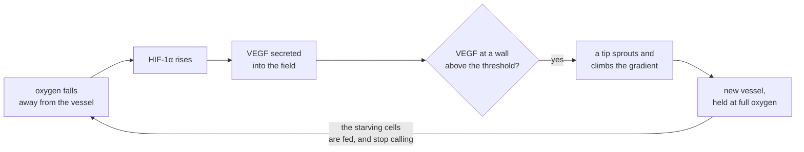

# 14. Vessels that grow

A tumour cord lives around its vessel out to the depth oxygen reaches, and starves beyond it. This chapter lets the starving cells call new vessels to them, and asks what the tumour becomes.

## In the body

**A tumour is limited by its vessels.** The cord of chapter 5 is not a model's quirk. Tannock (British Journal of Cancer, 1968) cut a transplanted mouse mammary tumour into sections and found its living tissue in cords around single vessels, with necrosis beyond them. Most cords had a radius between 60 and 120 µm, and cells divided less the further they lay from their vessel. A tumour that cannot get more vessels stays small. Gimbrone and colleagues (1972) placed tumour fragments where vessels could not reach them, and the fragments stayed small for as long as six weeks; their fast growth began when vessels arrived. Folkman and Hochberg (1973) saw the same limit in tumours grown in a dish, which stopped growing at a diameter of 3 to 4 mm.

**How new vessels grow.** Growing new vessels from existing ones is **angiogenesis**. Every vessel is lined by a thin layer of **endothelial cells**. Cells short of oxygen accumulate HIF-1α, hypoxia-inducible factor 1 alpha (chapter 2), which makes them secrete **VEGF**, vascular endothelial growth factor. VEGF diffuses away from them. Where it reaches a vessel, one endothelial cell becomes a **tip cell**: it puts out long thin protrusions and migrates towards the VEGF, and the endothelial cells behind it, the **stalk cells**, divide and make the tube of the new vessel. Gerhardt and colleagues (Journal of Cell Biology, 2003) separated the two roles in the retina of the mouse: "whereas tip cell migration depends on a gradient of VEGF-A, proliferation is regulated by its concentration", and they never found a tip cell dividing. A **sprout** that meets another vessel joins it, which is **anastomosis**, and blood can then flow through it.

**How fast, and how far.** Sprouts growing towards a tumour implanted in a rabbit's cornea advanced half a millimetre a day at first and a quarter to half a millimetre a day after, 10 to 21 µm an hour, and sprouts grown in a dish 5 to 27 µm an hour, as Bauer and colleagues (PLoS Computational Biology, 2009) collect the measurements. VEGF diffuses at about 10 µm² per second in tissue and decays at about 0.65 per hour, the values Shirinifard and colleagues (PLoS One, 2009) use, which would let it reach a couple of hundred micrometres; but much of it binds to the material between cells, and Gerhardt and colleagues saw the forms that bind make steeper gradients than the one that does not. How far VEGF carries in a real tumour is not well known.

Shirinifard and colleagues built a tumour with growing vessels in a three dimensional Cellular Potts model. This chapter does something simpler, in two dimensions, so that its consequences can be followed one at a time.

## In cellweave

**A call.** A network may name an **angiogenic** role, the node whose level a cell secretes as a call for vessels. `examples/networks/ras-erk.toml` names its VEGF node. In a scenario whose vessels can grow, every living cell secretes into a **VEGF field**, a second field beside the oxygen, at its angiogenic node's level times the field's decay rate, and the field diffuses and decays. Secreting at the decay rate makes the units simple: in tissue where every cell secretes the same level, the field settles at that level. The field is solved to equilibrium every step, like the oxygen (chapter 3), because VEGF spreads in minutes and a cell's cycle takes a day. How far a call carries is set by the decay rate: the field falls by a factor of e over a **reach** $L = \sqrt{D / \lambda}$, which the configuration states.

**A sprout.** A configuration may add:

```toml
[angiogenesis]
threshold = 0.5   # VEGF a wall has to read to sprout, and a tip to keep going
speed = 1.0       # pixels a tip advances per step
reach = 30.0      # pixels over which VEGF falls by a factor of e
```

Every step, after the networks have run, the field settles against what the living secrete, and then the vessels answer:

- **Each tip moves.** It reads the VEGF where it stands. Below the threshold, the call it followed has stopped and so does it. Otherwise it moves `speed` pixels up the field's gradient, and each time it reaches a new pixel it lays a disc of vessel there, five pixels across, the width of a capillary. The disc takes its pixels from whatever cells held them, and a cell left with none was crushed, and dies. A tip that reaches the edge of the box stops; one that comes within a pixel of another vessel joins it and stops.
- **One wall may sprout.** Of all the vessel pixels open to the tissue, the one reading the most VEGF, at least the threshold, sends out a new tip, unless a tip still growing or the start of another sprout lies within 16 pixels, about a cell's diameter. The spacing stands in for the way tip cells keep the endothelial cells next to them from becoming tips too. One sprout at most per step.
- **New vessel carries oxygen at once.** Every vessel pixel, old or new, is held at full oxygen. A new vessel also brings whatever else comes in where oxygen does, the lethal stress of chapter 8 included.



The loop closes on itself. A cell that is fed stops accumulating HIF-1α, stops calling, and a tip whose call has stopped stops growing.

**Nothing is drawn.** Which wall sprouts is the one reading the most VEGF, ties going to the first in reading order, and a tip goes where the gradient points. A run whose vessels may grow is the same run as without them, to the last bit, until the first sprout lays its first pixel, which a test checks. Two runs of a pair in a campaign therefore share their history up to there.

**What a run says.** `measurements.csv` gains two columns, `vessel`, the pixels of vessel, and `sprouts`, the tips still growing. `Simulation::depth_from_vessels` says how far living tissue reaches from its nearest vessel: the distance within which 95% of the living pixels lie. In a cord whose vessel does not grow, it is the cord's living depth. A run prints it with the sprouts and the vessel, and a campaign writes `necrotic`, `vessel`, `sprouted` and `depth` for each run and compares them pair by pair.

**Watching it.** In the viewer the new vessel is drawn as the old one is, raised and glowing, and grows on screen. Coloured by `vegf`, every pixel shows the call it sits in, and the panel counts the pixels of vessel and the sprouts still growing.

```bash
cd viewer
cargo run --release -- --config ../examples/cord-angiogenic.toml --view vegf
```

### The predictions, and what happened

`examples/cord-angiogenic.toml` is the cord of chapter 5 with vessels that may grow, in a box of 300 pixels so that a tumour that grows has room to show it; `examples/cord-wide.toml` is the same cord in the same box, with a vessel that does not grow. Paired under the same seeds, the two are one run until the first sprout lays its first pixel.

```bash
cellweave --config examples/cord-wide.toml --versus examples/cord-angiogenic.toml --seeds 1-10 --mcs 300
```

Written before any campaign, with the step to compare at chosen from one run under the default seed, which is not among the ten, and which touched the edge of the box at step 351:

- (a) more living cells with growing vessels in at least 9 pairs of 10, a median of at least one and a half times as many;
- (b) a smaller share of the tissue necrotic in at least 8;
- (c) the living tissue no further from its nearest vessel than a quarter beyond the cord's: new vessels would make more sleeves of living tissue, not thicker ones;
- (d) without growing vessels no run touches the edge of the box in 1500 steps, and with them at least 8 of 10 do.

At step 300:

| seed | living, cord | living, growing vessels | necrotic share | living tissue within, px of a vessel | sprouts | vessel pixels |
|---|---|---|---|---|---|---|
| 1 | 38 | 47 | 0.54 to 0.48 | 54.1 to 57.9 | 1 | 185 |
| 2 | 39 | 96 | 0.55 to 0.29 | 54.3 to 65.4 | 5 | 508 |
| 3 | 39 | 59 | 0.51 to 0.39 | 54.7 to 59.2 | 2 | 240 |
| 4 | 39 | 64 | 0.52 to 0.32 | 54.7 to 61.5 | 2 | 260 |
| 5 | 37 | 45 | 0.51 to 0.51 | 54.0 to 57.2 | 1 | 144 |
| 6 | 36 | 65 | 0.51 to 0.29 | 52.5 to 61.3 | 3 | 360 |
| 7 | 39 | 125 | 0.52 to 0.16 | 55.1 to 66.3 | 6 | 874 |
| 8 | 36 | 92 | 0.53 to 0.30 | 52.4 to 64.0 | 4 | 493 |
| 9 | 37 | 41 | 0.51 to 0.52 | 53.0 to 55.2 | 1 | 124 |
| 10 | 38 | 45 | 0.50 to 0.50 | 53.9 to 56.3 | 1 | 154 |

(a) **Held**: more living cells in all 10 pairs, a median of 1.58 times as many. (b) **Failed, narrowly**: the necrotic share fell in 7 pairs, not 8; in the three where a single sprout had started, it did not move. (c) **Held**: with growing vessels 95% of the living pixels lie within a median of 1.10 times the cord's distance of a vessel, between 1.04 and 1.22 times. The tumour that calls vessels grows the way the cord of chapter 5 lives: in sleeves around vessels, as thick as oxygen reaches, and more of them.

(d) **Half held.** Without growing vessels no run touched the edge of the box in 1500 steps. With them only one did: seed 7, at step 334, the one that had started the most sprouts. In the other nine the vessel at step 1500 was the vessel at step 300, to the pixel: every sprout had started before step 300, and the tumour then held its larger size for 1200 steps.

Why the vessels stopped was then guessed, and the guess tested. The living sleeve around a vessel is about 55 pixels deep, nearly twice VEGF's reach of 30, so once a sleeve has formed, the cells starving at its edge might call from too far away to be heard at any wall. If so, a call carrying 60 pixels would keep the vessels growing: written before running it, at least 6 runs of 10 would touch the edge within 800 steps. That **failed** completely: at a reach of 60 not one sprout started, in any of the ten runs. A call that carries further is also spread thinner, over tissue that secretes and tissue that does not, and here it never reached the threshold at a wall; chapter 15 finds the same at 100 pixels. At this threshold only a narrow range of reach lets a vessel sprout at all, and at 30 pixels every sprout started while the tumour was young. A threshold that is one absolute level of VEGF whatever the reach is the placeholder this points at.

How much a tumour gained followed how many sprouts it started, from a single one, which changed little, to six, which tripled the living. In this model a tumour does not switch from starving to fed: it is fed in proportion to the vessels it has managed to call.


### Blood only through loops

Blood flows through a vessel only if it can come in at one end and leave at the other. A sprout that has not joined anything is a blind end: blood cannot flow through it, and it brings nothing. A configuration may say so:

```toml
[angiogenesis]
perfusion = "on_joining"   # the default is "at_once"
```

Each sprout then remembers which vessel it grew from. Until its tip joins another vessel it is an obstacle and nothing more: cells cannot enter it, and it supplies no oxygen. When its tip joins one, a loop closes through the two, and blood flows through the sprout, through every sprout it grew from, through the vessel it joined and through everything that one grew from. The vessel laid at the start always carries blood. `Simulation::carries_blood` says whether a pixel of vessel does, and `measurements.csv` has a `perfused` column beside `vessel`. In the viewer a sprout without blood is drawn dark and gives off no light, and turns red when its loop closes.

`examples/cord-angiogenic-joining.toml` is `cord-angiogenic.toml` with `perfusion = "on_joining"`. Paired with it under the same seeds, the two are one run until the first sprout lays a pixel, which carries blood in one and not in the other.

```bash
cellweave --config examples/cord-angiogenic.toml --versus examples/cord-angiogenic-joining.toml --seeds 1-10 --mcs 300
```

Written before anything was run with it: (a) fewer living cells at step 300 when sprouts wait to join, in at least 8 pairs of 10; (b) still more than the plain cord of the first experiment under the same seed, in at least 6; (c) less than 60% of the vessel carrying blood at step 300, in the median.

| seed | living, plain cord | at once | once joined | vessel pixels, at once | once joined | of which carrying blood | sprouts, at once | once joined |
|---|---|---|---|---|---|---|---|---|
| 1 | 38 | 47 | 88 | 185 | 1424 | 73% | 1 | 11 |
| 2 | 39 | 96 | 105 | 508 | 1409 | 90% | 5 | 10 |
| 3 | 39 | 59 | 87 | 240 | 1840 | 62% | 2 | 11 |
| 4 | 39 | 64 | 49 | 260 | 216 | 100% | 2 | 2 |
| 5 | 37 | 45 | 54 | 144 | 201 | 100% | 1 | 2 |
| 6 | 36 | 65 | 58 | 360 | 343 | 88% | 3 | 3 |
| 7 | 39 | 125 | 68 | 874 | 1700 | 71% | 6 | 10 |
| 8 | 36 | 92 | 106 | 493 | 1363 | 82% | 4 | 10 |
| 9 | 37 | 41 | 38 | 124 | 144 | 78% | 1 | 1 |
| 10 | 38 | 45 | 63 | 154 | 2106 | 19% | 1 | 12 |

(a) **Failed**: the tumour whose sprouts had to join first had fewer living cells in only 4 pairs, and more in 6. (b) **Held**: more than the plain cord in all 10. (c) **Failed**: 80% of the vessel carried blood in the median.

The tumour that had to wait for loops did not end up with less vessel but with far more: a median of 1386 pixels against 250, and of 10 sprouts against 2, with half as many necrotic cells (19 against 39). A sprout that carries no blood feeds nobody, so the cells around it go on starving and calling, and the walls go on sprouting, until sprouts meet and the loops close. Perfused at once, the first sprout quiets the cells around it before a second is needed. Making blood wait for a loop takes away the feedback that stops a tumour calling, and the tumour calls in more vessel than it would have needed. Seed 10 shows it at its most: twelve sprouts, only a fifth of the vessel carrying blood at step 300, and still more living cells than either of the other two cords under the same seed.


## Choices, and why

**The vessel is an obstacle that grows.** A vessel was already a set of obstacle pixels held at full oxygen (chapter 5). New vessel is more of the same pixels, so everything that reads a vessel, the oxygen, the stress, the viewer, the measurements, reads the new vessel without a change.

**A tip is a point, not a cell.** Tip and stalk cells are not modelled as cells of the lattice: the tip is a point that moves, and the tube is laid behind it. What the chapter asks is what new vessels do to a tumour, not how endothelial cells build them.

**Perfused at once, unless told otherwise.** A real sprout carries blood once it has joined another vessel. By default a sprout here is held at full oxygen from its first pixel, which is generous to the tumour, and is what the first experiment used. `perfusion = "on_joining"` makes it wait, as the last section does.

**The speed is the fastest the model allows.** A tip may not move more than a pixel per step, or the vessel it lays has gaps. The cord has no calibrated step (chapter 12). If a cord cell's cycle stood for a day, the 110 steps or so a living cell takes to divide here would make a step about 13 minutes, and the measured 10 to 21 µm an hour would be 2 to 4 pixels per step, at about a micrometre per pixel. On that reading the model's sprouts are slower than real ones, not faster.

**The reach is a parameter.** A decay rate fixed in the code would hide the one number that decides how much of a cell's call is heard by its neighbours rather than by itself; the next chapter varies it.

**One sprout per step, deterministically.** Without a limit every wall pixel above the threshold would sprout at once. Choosing the strongest, rather than drawing one, keeps the run's random sequence the same as the run without growing vessels, which is what lets a campaign pair them.

## Where in the code

`crates/engine/src/vessels.rs`: `Tip`, `VESSEL_RADIUS`, the spacing of sprouts, how a tip moves, lays vessel and joins another. `crates/core/src/types.rs`: `Angiogenesis`. `crates/core/src/network.rs`: the `angiogenic` field of `Roles`. `crates/engine/src/network.rs`: `Network::angiogenic`. `crates/engine/src/pde.rs`: `ScalarField::set_production`, a source per pixel. `crates/engine/src/coupling.rs`: `apply_production`. `crates/engine/src/simulation.rs`: the `angiogenesis` field of `Scenario`, the VEGF field and its reach, where a step settles it and grows the vessels, `Simulation::vegf`, `Simulation::sprouts`, `Simulation::sprouted`. `crates/engine/src/measure.rs`: the `vessel` and `sprouts` columns, `Simulation::depth_from_vessels`, `DEPTH_SHARE`. `src/campaign.rs`: the columns and the lines a campaign adds.

`crates/core/src/types.rs`: `Perfusion`. `crates/engine/src/vessels.rs`: which sprout laid each pixel, what it grew from, and the loop that perfuses them. `crates/engine/src/coupling.rs`: `hold_vessels_at`. `crates/engine/src/simulation.rs`: `Simulation::carries_blood`. `crates/engine/src/measure.rs`: the `perfused` column.

`viewer/src/paint.rs`: the `Vegf` view, and `DRY_VESSEL` for a sprout without blood. `viewer/src/panel.rs`: the vessel line.

`examples/cord-angiogenic.toml`, its twin `examples/cord-wide.toml`, and `examples/cord-angiogenic-joining.toml`.

## Still a placeholder

The threshold, one absolute level of VEGF whatever the reach, which lets vessels sprout only in a narrow range of reach; the reach; the spacing of 16 pixels; the width of a new vessel. Vessels never regress, and with `perfusion = "on_joining"` any loop carries blood, however long and however it closed. There is no blood flow, so a vessel far from where it started carries as much oxygen as the one it came from. Endothelial cells are not cells, and there is only one kind of vessel. Everything is in two dimensions, where a real sprout can pass above or below the tissue in its way.

## References

- Bauer AL, Jackson TL, Jiang Y. [Topography of extracellular matrix mediates vascular morphogenesis and migration speeds in angiogenesis](https://doi.org/10.1371/journal.pcbi.1000445). *PLoS Computational Biology* 5, e1000445 (2009). [Free full text](https://europepmc.org/article/PMC/PMC2709079).
- Folkman J, Hochberg M. [Self-regulation of growth in three dimensions](https://doi.org/10.1084/jem.138.4.745). 138, 745-753 (1973). [Free full text](https://europepmc.org/article/PMC/PMC2180571).
- Gerhardt H, Golding M, Fruttiger M, et al. [VEGF guides angiogenic sprouting utilizing endothelial tip cell filopodia](https://doi.org/10.1083/jcb.200302047). *Journal of Cell Biology* 161, 1163-1177 (2003). [Free full text](https://europepmc.org/article/PMC/PMC2172999).
- Gimbrone MA, Leapman SB, Cotran RS, et al. [Tumor dormancy in vivo by prevention of neovascularization](https://doi.org/10.1084/jem.136.2.261). 136, 261-276 (1972). [Free full text](https://europepmc.org/article/PMC/PMC2139203).
- Shirinifard A, Gens JS, Zaitlen BL, et al. [3D multi-cell simulation of tumor growth and angiogenesis](https://doi.org/10.1371/journal.pone.0007190). *PLoS One* 4, e7190 (2009). [Free full text](https://europepmc.org/article/PMC/PMC2760204).
- Tannock IF. [The relation between cell proliferation and the vascular system in a transplanted mouse mammary tumour](https://doi.org/10.1038/bjc.1968.34). *British Journal of Cancer* 22, 258-273 (1968). [Free full text](https://europepmc.org/article/PMC/PMC2008239).
