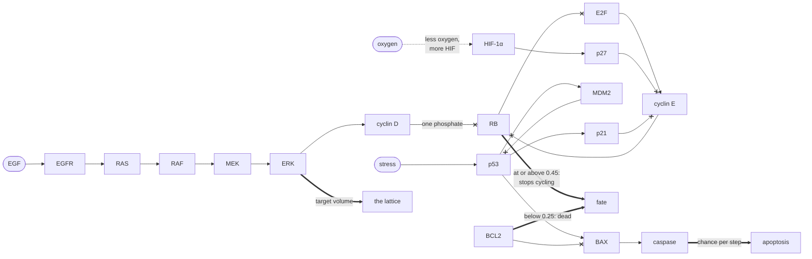

# 28. Inside one cell

What lies between what a cell reads and what it decides, and how is one cell opened to watch it?

## In the body

Chapter 2 gave each cell five proteins, and said what it left out: between a growth factor outside the cell and the decision to divide there are a dozen proteins, and as many between a damaged cell and its death. This chapter puts them back. Each is named here before it is used.

**The growth relay.** **EGF** (epidermal growth factor) is a small protein outside the cell. It binds **EGFR** (the EGF receptor), a protein that crosses the cell's membrane, and the part of the receptor inside the cell becomes a **kinase**: an enzyme that switches other proteins on by attaching a phosphate group to them, which is called **phosphorylation**. The receptor switches on **RAS** (first found in a rat sarcoma, hence the name), a switch held on the inside of the membrane. RAS switches on **RAF** (rapidly accelerated fibrosarcoma), a kinase; RAF phosphorylates **MEK** (MAPK/ERK kinase), and MEK phosphorylates **ERK** (extracellular signal-regulated kinase), which goes into the nucleus and changes which genes are read (Lemmon and Schlessinger, Cell, 2010). RAF, MEK and ERK together are the **MAPK cascade** (mitogen-activated protein kinase). MEK and ERK each need two phosphates to be active. A kinase that must add two before its target works has to find it twice, and the response of the target then rises more than in proportion to the kinase above it: Huang and Ferrell measured it in frog eggs, where ERK goes from nearly off to nearly on over a narrow range of the signal (PNAS, 1996).

**The cell cycle.** Chapter 27 named its phases: a first gap (G1), the copying of the DNA (S), a second gap and mitosis. Whether a cell leaves G1 for S is the decision that matters, and it is held by **RB** (the retinoblastoma protein, named after the eye tumour its loss causes). RB binds **E2F** (E2 promoter binding factor), the transcription factor that reads the genes needed to copy DNA, and while bound E2F reads nothing. RB is released by being phosphorylated, by kinases that work only when bound to a **cyclin**, hence their name, **CDK** (cyclin-dependent kinase). ERK has the cell make **cyclin D** (Lavoie and colleagues, J Biol Chem, 1996), whose kinase puts a single phosphate on RB, which does not release it (Narasimha and colleagues, eLife, 2014); E2F, once some is free, has the cell make **cyclin E**, whose kinase phosphorylates RB fully and frees more E2F. That is a loop: the less RB holds, the more cyclin E, the less RB holds. Past a point the cell is committed and divides whatever the growth factor does next, which is called the **restriction point**, and the loop is what makes it a switch (Yao and colleagues, Nat Cell Biol, 2008).

**The brakes.** Two proteins block the cyclin E kinase, and with it the loop. **p27** (p27Kip1, chapter 27) is made when HIF-1α (hypoxia-inducible factor 1α, chapter 2) rises: without oxygen, cells raise p27 and stop in G1, and cells unable to make HIF-1α do not stop (Gardner and colleagues, J Biol Chem, 2001; Goda and colleagues, Mol Cell Biol, 2003). **p21** (p21Cip1, also called WAF1) is made when **p53** rises (el-Deiry and colleagues, Cell, 1993), and blocks the same kinases (Harper and colleagues, Cell, 1993). This is the half of p53 that chapter 8 described and left out: low, it pauses the cell.

**The way to apoptosis.** p53 is held down in a healthy cell by **MDM2** (mouse double minute 2), which marks it for destruction (Haupt and colleagues, Nature, 1997). p53 has the cell make MDM2, so a rise of p53 brings on what lowers it again (Wu and colleagues, Genes Dev, 1993). p53 also has the cell make **BAX** (BCL2-associated X protein; Miyashita and Reed, Cell, 1995), which opens the mitochondria and lets out what starts the **caspases** of chapter 8. **BCL2** (B-cell lymphoma 2, chapter 2) binds BAX and holds it back (Oltvai and colleagues, Cell, 1993): survival and apoptosis meet on that pair.

## In cellweave

`examples/networks/fuller-cell.toml` is that network: eighteen proteins where chapter 2 has five and chapter 8 seven. It extends `stress-response.toml`, which extends `ras-erk.toml`, and adds or replaces only what this chapter fills in. HIF-1α, VEGF (vascular endothelial growth factor) and BCL2 are inherited unchanged.



An arrow switches its target on, a cross switches it off. HIF-1α's arrows to VEGF and BCL2, and ERK's to BCL2, are chapter 2's and not drawn again.

### A new term

Switching off is what most of these proteins do to each other, and chapter 2's catalogue had no term for it. It has one now, `inhibited_by`: `- rate * source * self`, the mirror of `activated_by`. The node is lost in proportion to how much of it there is and how much of the source, which is what a kinase that inactivates its target does, or a protein that marks another for destruction. It takes a Hill response as `activated_by` does. In the code it is `Term::InhibitedBy`, and a test checks that its slope is what its documentation says and that it empties a node without taking it below zero.

### Rates set by what was calibrated

None of the rates is measured; no study measures them in the units of a model whose levels are fractions between 0 and 1. They are chosen instead so that the fuller cell decides what the simpler networks decide, at the same places, which chapters 25 and 27 fixed against measured spheroids. The tests in `crates/io/tests/fuller_cell.rs` hold them there:

- **The same size.** ERK settles at 0.333 in both, so a cell asks for the same target volume. The relay has two more steps and each saturates, which would damp the signal; the Hill response of order two on MEK and on ERK, which is the double phosphorylation above, gives it back. With RAS stuck on, as in chapter 2's mutant, ERK reaches 0.553 through RAF and MEK against 0.556 without them.
- **The same arrest.** The cell stops dividing when RB is on: the network's `hypoxia_response` role, the node whose height stops the cycle (chapter 4), is RB, against the same threshold of 0.45. It is the role's old name; what turns RB on here is p27 or p21, and with neither RB settles at 0.23. p27's half way point, 0.549, is the one number set to place the arrest: a well-stimulated cell crosses 0.45 at 31.8% of the source's oxygen, where HIF-1α crosses it in the simpler network.
- **The same death.** BCL2 is inherited, so a cell dies of anoxia where it did.
- **The same apoptosis.** Caspase answers a stress within 0.015 of what it did in `stress-response.toml`: 0.028 a step against 0.017 at a fifth of the full stress, 0.287 against 0.299 at all of it. MDM2 holds p53 lower than the stress alone would, 0.39 against 0.50 at full stress, and BAX carries it the rest of the way.

Another checks that the cycle has no memory: started arrested, RB fully on and E2F and cyclin E off, a cell settles where one started cycling does, at every oxygen. Another, that the file's initial levels are the well-fed steady state, so the first cell does not spend its first steps catching up.

### What is new

Two things the simpler networks could not do.

**p21 adds to p27.** On its own, at the stresses the model knows, p21 pushes RB up without reaching the threshold: 0.448 at full stress in full oxygen. With some hypoxia as well, the two brakes on cyclin E add up and the cell stops: 5 points of oxygen above where a calm cell would stop, a stressed one already has.

**BCL2 shields from apoptosis.** BAX is held back by BCL2, so a cell whose BCL2 is high, fed by ERK and by HIF-1α, resists the stress more, and a cell whose BCL2 the anoxia is breaking down resists it less.

### Run against the simpler networks

**The spheroid.** `spheroid-fuller.toml` is chapter 25's calibrated spheroid with the fuller cell. Its first cell starts at the well-fed steady state rather than with ERK at 0.05, so it grows a few steps sooner and the run stays about fourteen steps ahead. Measured by size rather than by step, the two are the same: the first cell stops dividing when the spheroid's radius is 167.9 pixels in both. The first cell dies at a radius of 197.4 pixels against 197.3, where chapter 25 placed the core. Grown to a radius of 320 pixels, its dead core reaches 166.7 pixels from the centre against 166.6, and its living rim is 153.3 pixels deep against 153.5. At the last step, 625, the fuller spheroid is still thirteen steps ahead, 345.5 pixels against 337.6.

**The stressed cord.** `cord-stress-fuller.toml` is chapter 8's cord under a continuous stress from step 800, with the fuller cell. This was not predicted before it ran. With the simpler network the cord keeps dividing beside its vessel while the stress thins it: 153 births from step 800 to step 1500, 33 cells living at step 1500, and 24 at step 3000, all of them arrested. With the fuller cell, not one cell divides once the stress is on, and the cord dwindles to 4 cells at step 1500 and 1 at step 3000. The cord's cells already carry some p27, from the oxygen gradient around the vessel; p21 adds to it, and the cells the stress reaches stop dividing before it kills them, so nothing replaces the dead. Run again with p21's brake on cyclin E taken out of the file, the fuller cord divides again: 106 births by step 1500, 19 cells living. p21 accounts for most of the difference; the rest is BAX, which BCL2 holds back less in the cells the anoxia is breaking down.

Whether that is what a tumour does depends on what the stress is. The lethal stress here kills a cell whether it divides or not. Many real agents kill dividing cells far more readily, and against them an arrest would shield a cell rather than doom the tissue: the model cannot tell the two apart until its stress says which it is.

### Opening a cell

The viewer opens any cell. A click on a cell, one that does not drag, opens a window beside the tissue, and the cell's outline turns white. The window draws the cell's own network as it stands at the last step shown. What the cell reads from outside is on the left: oxygen, EGF, the stress, each at the level around it. Each protein is a box in the colour the tissue takes when coloured by that protein, with its level. Each term that reads something is an arrow: green where it switches its target on, red where it switches it off, dashed where it acts by an absence or a shortage, and as thick as it is pushing now, its contribution to its target's rate of change. A loop is drawn back under the boxes. The proteins that answer the simulation's questions carry their answer underneath, lit while it is the one given: size, arrest, alive, apoptosis, vessels.

Below the diagram the window says, in words, what the cell does with those levels: whether it divides and why, how large it asks to be, whether it is alive, its chance of apoptosis this step. A plot follows the proteins that decide over the steps since the cell was opened. Hovering over a protein lists every term that moves it with its rate and what it adds now; clicking it colours the whole tissue by that protein, so the cell can be set against its neighbours. The camera can follow the cell as it is pushed about.

The diagram is laid out from the network rather than drawn by hand: what the cell reads goes in the first column, each protein one column past the furthest of what it reads, and a link that closes a loop is set aside for the purpose. Any network a configuration names is drawn, and so is a cell whose mutations gained or lost a link (chapter 9), since the window draws that cell's own terms.

From the command line, `--open x,y` opens the cell under a pixel, at the first step or at `--open-at`; `--follow` keeps the camera on it; `--protein rb` colours the tissue by a protein from the start; and `--window 1920x1080` sets the size of the window and of every frame recorded.

```sh
cd viewer
cargo run --release -- --config ../examples/spheroid-fuller.toml --open 400,400 --open-at 300 --follow --zoom 3
```

That opens the cell at the centre of the spheroid at step 300. Its oxygen is already down to 0.42 of the bath's, its HIF-1α at 0.41 and its p27 at 0.59, and its RB at 0.443, just short of the threshold. A few steps later RB crosses it and the cell stops dividing, inside a ring of cells doing the same. Then the oxygen around it falls under the anoxia threshold, its BCL2 collapses past 0.25 around step 375, and it dies, among the first cells of the core. The first cell of all, opened at step 0 instead, is not a good one to follow in this run: it keeps its number at each division while its daughters take new ones, and by step 278 it is at the rim.

## Choices, and why

**Tuned to the simpler networks rather than to new data.** The decisions of the simpler networks are the part of the model that was measured against something. A fuller network that moved them would need calibrating again, against data that do not separate one protein from the next. Holding the decisions where they were lets the proteins be added without unsettling any result that rests on them, and the tests say so if a later change does.

**RB, not p27, decides.** Chapter 27's `ras-erk-waste.toml` gives the arrest role to p27. Here p27 is one of two brakes, and what both act on is RB, which is where the cell's commitment is decided.

**No switch with memory.** The real restriction point is bistable: once past it, the cell divides even if the signal goes. Making it so here would have needed rates past what RK4 at one unit of network time per step integrates stably, and a cell that had stopped for lack of oxygen would not start again when it regains some, which the calibrated networks do. The loop is there, and it steepens the response, but it holds no memory.

**p21 alone does not stop the cycle.** How far p53 must rise before p21 alone stops a cell is not something these rates could be set by. Set at full stress just short of the threshold, p21 is visible in the window and acts with hypoxia, and stopping the cycle on stress alone is left to be measured.

## Where in the code

`crates/core/src/network.rs` has `Term::InhibitedBy`, and `crates/engine/src/network.rs` evaluates it in `term_rate`, the one place every term's contribution is worked out, both for `derivatives` and for `Network::influences`. `Influence` is one term as it stands: the node it moves, its kind, what it reads, its rate, and what it adds now. That is what the window draws as an arrow.

`crates/engine/src/simulation.rs` has `Simulation::inputs`, what a cell reads from where it sits, the fields averaged over its pixels by `mean_in` in `crates/engine/src/coupling.rs`. `DEATH_THRESHOLD`, `QUIESCENCE_THRESHOLD` and `DIVISION_RATIO` are public, so that the window can say how far a cell is from each.

`viewer/src/inspect.rs` is the window: `Inspected` is which cell is open and what was read of it, `pick` turns a click into a pixel by marching down the camera's ray to the relief, `read` reads the cell between two batches, `follow` moves the camera, and `window` draws it. `viewer/src/diagram.rs` lays the network out, `Layout`, and draws it. `viewer/src/paint.rs` outlines the open cell with `OPEN_MEMBRANE`.

`examples/networks/fuller-cell.toml` is the network. `examples/spheroid-fuller.toml` and `examples/cord-stress-fuller.toml` are the spheroid of chapter 25 and the stressed cord of chapter 8 with it.

## Still a placeholder

Every rate. The links are the literature's; their strengths are set so that the decisions land where the simpler networks put them, and so they say nothing the simpler networks did not, except where the new links act together, as p21 with p27 and BCL2 with BAX.

The levels are fractions of a protein's possible activity, not concentrations, and a protein is one number for the whole cell.

Much is still missing between these proteins: the second loop that makes the restriction point remember, the pulses of p53 that MDM2 makes in single cells, the growth of a cell's mass that mTOR (mechanistic target of rapamycin) drives apart from its division, the PI3K and AKT pathway beside RAS, MYC.

## References

- Lemmon MA, Schlessinger J. [Cell signaling by receptor tyrosine kinases](https://doi.org/10.1016/j.cell.2010.06.011). *Cell* 141, 1117-1134 (2010). [Free full text](https://europepmc.org/article/PMC/PMC2914105).
- Huang CY, Ferrell JE. [Ultrasensitivity in the mitogen-activated protein kinase cascade](https://doi.org/10.1073/pnas.93.19.10078). *PNAS* 93, 10078-10083 (1996). [Free full text](https://europepmc.org/article/PMC/PMC38339).
- Lavoie JN, L'Allemain G, Brunet A, Müller R, Pouysségur J. [Cyclin D1 expression is regulated positively by the p42/p44MAPK and negatively by the p38/HOGMAPK pathway](https://doi.org/10.1074/jbc.271.34.20608). *J Biol Chem* 271, 20608-20616 (1996).
- Narasimha AM, Kaulich M, Shapiro GS, Choi YJ, Sicinski P, Dowdy SF. [Cyclin D activates the Rb tumor suppressor by mono-phosphorylation](https://doi.org/10.7554/eLife.02872). *eLife* 3, e02872 (2014). [Free full text](https://europepmc.org/article/PMC/PMC4076869).
- Yao G, Lee TJ, Mori S, Nevins JR, You L. [A bistable Rb-E2F switch underlies the restriction point](https://doi.org/10.1038/ncb1711). *Nat Cell Biol* 10, 476-482 (2008).
- Gardner LB, Li Q, Park MS, Flanagan WM, Semenza GL, Dang CV. [Hypoxia inhibits G1/S transition through regulation of p27 expression](https://doi.org/10.1074/jbc.M010189200). *J Biol Chem* 276, 7919-7926 (2001).
- Goda N, Ryan HE, Khadivi B, McNulty W, Rickert RC, Johnson RS. [Hypoxia-inducible factor 1alpha is essential for cell cycle arrest during hypoxia](https://doi.org/10.1128/MCB.23.1.359-369.2003). *Mol Cell Biol* 23, 359-369 (2003). [Free full text](https://europepmc.org/article/PMC/PMC140666).
- el-Deiry WS, Tokino T, Velculescu VE, et al. [WAF1, a potential mediator of p53 tumor suppression](https://doi.org/10.1016/0092-8674(93)90500-P). *Cell* 75, 817-825 (1993).
- Harper JW, Adami GR, Wei N, Keyomarsi K, Elledge SJ. [The p21 Cdk-interacting protein Cip1 is a potent inhibitor of G1 cyclin-dependent kinases](https://doi.org/10.1016/0092-8674(93)90499-G). *Cell* 75, 805-816 (1993).
- Wu X, Bayle JH, Olson D, Levine AJ. [The p53-mdm-2 autoregulatory feedback loop](https://doi.org/10.1101/gad.7.7a.1126). *Genes Dev* 7, 1126-1132 (1993).
- Haupt Y, Maya R, Kazaz A, Oren M. [Mdm2 promotes the rapid degradation of p53](https://doi.org/10.1038/387296a0). *Nature* 387, 296-299 (1997).
- Miyashita T, Reed JC. [Tumor suppressor p53 is a direct transcriptional activator of the human bax gene](https://doi.org/10.1016/0092-8674(95)90412-3). *Cell* 80, 293-299 (1995).
- Oltvai ZN, Milliman CL, Korsmeyer SJ. [Bcl-2 heterodimerizes in vivo with a conserved homolog, Bax, that accelerates programmed cell death](https://doi.org/10.1016/0092-8674(93)90509-O). *Cell* 74, 609-619 (1993).
