# The course

What cellweave simulates, explained from the biology up, one notion at a time, in the order the software needed them. Every chapter says what a thing is in the body, what cellweave makes of it, which choices were made and why, where in the code it lives, and what is still a placeholder. The point is to be able to come back in six months and understand the program, not only run it.

Each chapter follows the same shape:

- **In the body**: the biology, defined before it is used.
- **In cellweave**: the model, with a diagram.
- **Choices, and why**: what was decided, and what it costs.
- **Where in the code**: file and symbol, so the claim can be checked.
- **Still a placeholder**: what is a number picked to make something show, not a measurement.
- **References**: the papers the chapter cites, each linked, with a link to its full text where it is free to read.

Chapters build on each other and are meant to be read in order the first time.

| | Chapter | The question it answers |
|---|---|---|
| 1 | [A cell is a set of pixels](01-a-cell-is-a-set-of-pixels.md) | How can a cell have a shape, push on its neighbours, and move, without anyone telling it where to go? |
| 2 | [What happens inside a cell](02-what-happens-inside-a-cell.md) | How does a cell know there is food outside, and decide to grow? |
| 3 | [Oxygen](03-oxygen.md) | Where does oxygen come from, how far does it get, and why is it already at equilibrium whenever a cell looks? |
| 4 | [What a cell does with what it reads](04-what-a-cell-does-with-what-it-reads.md) | Grow, wait, or die: how one number becomes a fate, and how a cell splits in two. |
| 5 | [Two tissues](05-two-tissues.md) | A spheroid that starves from the inside, and a cord that lives around a vessel and never stops turning over. |
| 6 | [A population that evolves](06-a-population-that-evolves.md) | What happens when a daughter is not quite a copy, and nobody says which change is good? |
| 7 | [A tissue that holds its size](07-a-tissue-that-holds-its-size.md) | How does normal tissue stay the same size while renewing itself, and what happens to it as mutations pile up? |
| 8 | [A lethal stress](08-a-lethal-stress.md) | How does a cell die on purpose, and what happens to a tissue when something from outside makes it? |
| 9 | [Rewinding a history](09-rewinding-a-history.md) | Which events made a tumour, and which only came along? |
| 10 | [Many histories, paired](10-many-histories-paired.md) | How often does a hypothesis do what it does, and how are two of them compared fairly? |
| 11 | [Why NOTCH wins](11-why-notch-wins.md) | Which of chapter 7's assumptions let the wrong clones win, and what it takes for NOTCH clones to cover the layer as they do in the oesophagus? |
| 12 | [Units](12-units.md) | How long is a step, and does the sheet obey the laws a real renewing epithelium does? |
| 13 | [Purged by its neighbours](13-purged-by-its-neighbours.md) | What happens to an early tumour that arises among the mutant clones of an ageing epithelium? |
| 14 | [Vessels that grow](14-vessels-that-grow.md) | What happens to a tumour cord when the cells starving at its edge can call new vessels to them? |
| 15 | [A call heard by its neighbours](15-a-call-heard-by-its-neighbours.md) | When a cell calls for vessels, how much of what comes goes to the cells that called? |
| 16 | [Vessels that regress](16-vessels-that-regress.md) | When sprouts that carry no blood are taken back, does a tumour still call in more vessel than it needs? |
| 17 | [Cells pushed aside](17-cells-pushed-aside.md) | How many cells does a growing vessel crush, and do the results of chapter 14 hold when it pushes them aside instead? |
| 18 | [A capillary in the plane](18-a-capillary-in-the-plane.md) | What does a tumour do against a vessel lying across the tissue rather than one seen end on, and can it make blood flow? |
| 19 | [Blood that flows](19-blood-that-flows.md) | When blood goes only where pressure drives it, how much of a tumour's new vessel carries any, and what does the tumour make of it? |
| 20 | [What blood delivers](20-what-blood-delivers.md) | When a vessel delivers oxygen in proportion to the blood through it, what does a tumour make of vessels that carry little? |
| 21 | [Pruned by the flow](21-pruned-by-the-flow.md) | When vessels carrying too little blood are pruned, as real networks prune them, does the network shrink, and does the tumour lose by it? |
| 22 | [What the model does not say](22-what-the-model-does-not-say.md) | The placeholders, the missing units, and why emergence is the whole point. |
| | [Glossary](glossary.md) | Every word, in one place. |

## How the chapters map onto the code

```mermaid
flowchart LR
    c1["1. pixels, energy,<br/>Monte Carlo"] --> cpm["crates/engine/src/cpm.rs<br/>CpmLattice"]
    c2["2. proteins,<br/>signalling"] --> net["crates/core/src/network.rs<br/>the hypothesis as written"]
    c2 --> run["crates/engine/src/network.rs<br/>Network, it made runnable"]
    c2 --> files["examples/networks/*.toml"]
    c3["3. oxygen"] --> pde["crates/engine/src/pde.rs<br/>ScalarField"]
    c3 --> cpl["crates/engine/src/coupling.rs"]
    c4["4. fates,<br/>division"] --> sim["crates/engine/src/simulation.rs<br/>Simulation, the loop"]
    c4 --> cpm
    c5["5. two tissues"] --> cfg["crates/core/src/types.rs<br/>OxygenSource"]
    c5 --> ex["examples/*.toml"]
    c5 --> mea["crates/engine/src/measure.rs<br/>Measurements"]
    c6["6. mutation,<br/>clones"] --> evo["crates/engine/src/evolution.rs<br/>CloneRecord"]
    c6 --> run
    c7["7. epithelium,<br/>crowding"] --> sim
    c7 --> epi["examples/networks/epithelium.toml"]
    c8["8. apoptosis,<br/>lethal stress"] --> sim
    c8 --> str["examples/networks/stress-response.toml"]
    c9["9. counterfactuals"] --> att["src/attribute.rs"]
    c9 --> evo
    c10["10. campaigns"] --> camp["src/campaign.rs"]
    c11["11. competition,<br/>coverage"] --> evo
    c11 --> nop["examples/networks/epithelium-no-pressing.toml"]
    c12["12. units,<br/>sister fates"] --> sis["crates/engine/src/sisters.rs"]
    c12 --> conf["crates/io/src/config.rs<br/>hours_per_step"]
    c13["13. a lesion<br/>in the sheet"] --> sim
    c13 --> les["examples/networks/lesion.toml"]
    c14["14. vessels<br/>that grow"] --> ves["crates/engine/src/vessels.rs<br/>sprouts and tips"]
    c14 --> pde
    c14 --> sim
    c15["15. a patch that<br/>does not call"] --> sim
    c15 --> sil["examples/networks/ras-erk-silent.toml"]
    c16["16. vessels<br/>that regress"] --> ves
    c16 --> cpm
    c17["17. cells<br/>pushed aside"] --> cpm
    c17 --> ves
    c18["18. a capillary<br/>in the plane"] --> cfg
    c18 --> mea
    c19["19. blood<br/>that flows"] --> flo["crates/engine/src/flow.rs<br/>pressures and flows"]
    c19 --> ves
    c20["20. what blood<br/>delivers"] --> cpl
    c20 --> flo
    c21["21. pruned<br/>by the flow"] --> ves
```

The README at the root of the repository says what works and what does not today. This course says why.
